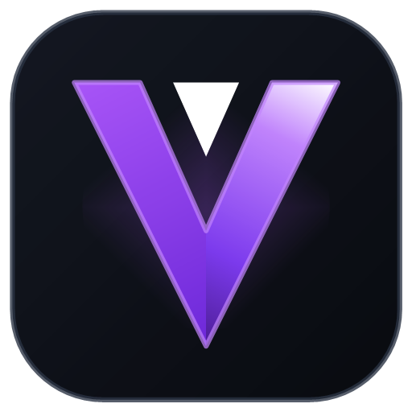
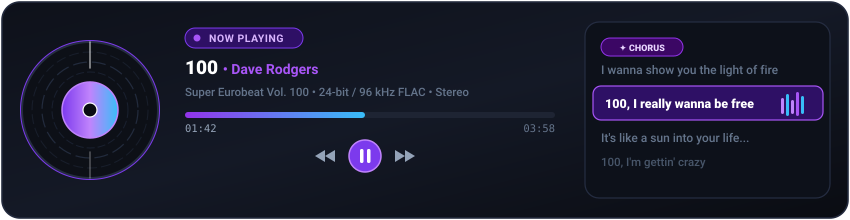

<p align="center">
  
</p>

<h1 align="center">VISTARA — Personal Media Universe</h1>

<p align="center">
  <strong>Local-First, Zero-Login Personal Media & Entertainment Platform for Windows</strong><br>
  <em>Combine the cinematic richness of a premium desktop media centre with the agility of modern web technologies.</em>
</p>

<p align="center">
  
  
  
  
  
  
  
</p>

<p align="center">
  
</p>

<p align="center">
  
</p>

---

## Table of Contents

1. [Overview & Core Philosophy](#1-overview--core-philosophy)
2. [Key Capabilities & Modules](#2-key-capabilities--modules)
3. [Supported Media Formats & Codecs Matrix](#3-supported-media-formats--codecs-matrix)
   - [Video Formats & Capabilities](#-video-formats--capabilities)
   - [Audio Formats & Lossless Studio Pipeline](#-audio-formats--lossless-studio-pipeline)
   - [Photo & Graphic Formats](#-photo--graphic-formats)
4. [Technology Stack & Architecture](#4-technology-stack--architecture)
5. [Quick Start — Running VISTARA](#5-quick-start--running-vistara)
6. [Directory & Project Layout](#6-directory--project-layout)
7. [Detailed Features](#7-detailed-features)
   - [Zero-Login & Local Security Barrier](#zero-login--local-security-barrier)
   - [Cinematic Startup Screen & Synthesized Soundscape](#cinematic-startup-screen--synthesized-soundscape)
   - [Media Library Scanner & File Protection](#media-library-scanner--file-protection)
   - [Cinema, Multi-Editions & Continue Watching](#cinema-multi-editions--continue-watching)
   - [TV Shows & Season Management](#tv-shows--season-management)
   - [Music Studio, Now Playing & 60 FPS Visualizers](#music-studio-now-playing--60-fps-visualizers)
   - [DJ Crossfade, Synced Lyrics & Sleep Timer](#dj-crossfade-synced-lyrics--sleep-timer)
   - [Smart Dynamic Mixes & Curated Playlists](#smart-dynamic-mixes--curated-playlists)
   - [10-Band Graphic Equalizer with Genre Presets](#10-band-graphic-equalizer-with-genre-presets)
   - [Photo Studio & EXIF Timeline](#photo-studio--exif-timeline)
   - [Adaptive Playback, Fullscreen & Hardware Acceleration](#adaptive-playback-fullscreen--hardware-acceleration)
   - [Open-Source Online Subtitle Engine](#open-source-online-subtitle-engine-movies--tv-series)
   - [Open-Source Synced Lyrics Engine (LRCLIB)](#open-source-synced-lyrics-engine-lrclib-integration)
8. [Keyboard Shortcuts Matrix](#8-keyboard-shortcuts-matrix)
9. [Building from Source](#9-building-from-source)
10. [Automated Testing & Verification](#10-automated-testing--verification)
11. [Documentation Suite](#11-documentation-suite)
12. [Troubleshooting & Support](#12-troubleshooting--support)

---

## 1. Overview & Core Philosophy

**VISTARA** is a production-quality, Windows-first media hub engineered to organise, browse, play, and safeguard your personal media collections across movies, television series, high-resolution music, and photo memories.

### Foundational Principles

* **100% Local-First & Zero-Cloud:** Runs completely offline without external internet dependence or external tracking.
* **Zero-Login Experience:** No login screens, no account creation, no password prompts. Opens directly into the Dashboard.
* **No Docker Required:** Self-contained native Windows executables without container overhead or virtualization dependencies.
* **Original Media File Safety:** Read-only access to user files. Original audio, video, and image assets are NEVER altered, remuxed in-place, or deleted without explicit confirmation.
* **Strict Visual Identity (No Gradients):** High-contrast cinematic dark theme built with solid matte dark surfaces (`#0b0d11`, `#12151b`, `#181c24`), clean borders (`#242a36`), and vibrant solid accents (`#7c3aed`).
* **Dual Operating Modes:**
  * **Desktop Mode:** WPF container with Microsoft Edge WebView2, custom title bar, fullscreen toggle (`F11`), and system tray minimization.
  * **Browser Mode:** Accessible from any browser at `http://127.0.0.1:5178/`, sharing the identical backend and SQLite database.
* **Strict Loopback Binding:** Bound strictly to `127.0.0.1:5178`. Never exposed to public networks or local area networks.

---

## 2. Key Capabilities & Modules

| Module | Features & Capabilities |
| :--- | :--- |
| **Dashboard** | Dynamic customizable widgets, *Continue Watching* with accurate progress tracking, *Recently Added*, library statistics, storage usage graphs, and real-time background task monitors. |
| **Cinema** | Grid/List view, movie details, cast & crew, genres, release dates, runtime, community ratings, bookmarks, and **First-Class Multi-Edition Support** (e.g., 4K UHD, 1080p, Director's Cut grouped under a single movie card without duplicate clutter). |
| **TV Shows** | Series banners, season selector, episode lists, episode progress tracking, auto season/episode filename identification (`S01E02`, `1x02`, `Season 1 Episode 2`), and next-episode autoplay. |
| **Music Studio** | Tracks, albums, artists, embedded ID3 tags, cover art, persistent mini-player, queue management, lyrics support, shuffle, repeat, **Immersive Now Playing Studio Screen**, **60 FPS Real-Time Audio Visualizers** (5 styles: Spectrum Bars, Liquid Wave, Radial Halo, Cosmic Embers, Analog VU Meters), and an integrated **10-Band Graphic Equalizer** with 8 genre presets powered by Web Audio API. |
| **Photo Gallery** | Chronological timeline, smart album grouping, full-screen lightbox viewer with zoom/rotate, EXIF metadata drawer (aperture, ISO, focal length, camera make/model), and multi-selection. |
| **Libraries Engine** | Multi-folder support per library, incremental scanning, real-time SignalR progress updates, duplicate detection via fast SHA-256 headers, and safe preservation of missing files. |
| **Player Pipeline** | 3-tier streaming architecture (**DirectPlay** $\rightarrow$ **Remux** $\rightarrow$ **HLS Transcode**) with automatic detection of GPU acceleration (**NVIDIA NVENC, Intel QSV, AMD AMF, DXVA2, D3D11VA**), borderless Fullscreen toggle (<kbd>F</kbd> / <kbd>F11</kbd>), responsive volume slider, and online open-source subtitles. |

---

## 3. Supported Media Formats & Codecs Matrix

VISTARA features an adaptive hybrid media pipeline that combines zero-overhead native direct playback with hardware-accelerated on-the-fly streaming. Original media files on disk are **never modified, re-tagged, or altered**.

### 🎬 Video Formats & Capabilities

| Container / Format Logo | Native Direct Play | Remuxing (Zero Re-Encode) | Adaptive HLS Transcoding | Supported Video Codecs | Supported Audio Tracks |
| :--- | :---: | :---: | :---: | :--- | :--- |
| <br>`.mp4` • `.m4v` | ✅ Yes | ✅ Direct Pass | ✅ Auto (if needed) | H.264 / AVC, H.265 / HEVC, AV1 | AAC, AC3, MP3, Opus |
| <br>`.mkv` (Matroska) | ✅ Direct / Remux | ✅ Instant (~10ms) | ✅ Hardware NVENC/QSV | H.264, H.265, VP9, AV1, VC-1 | DTS, DTS-HD, TrueHD, AC3, E-AC3, AAC, FLAC |
| <br>`.webm` | ✅ Yes | ✅ Direct Pass | ✅ Auto | VP8, VP9, AV1 | Opus, Vorbis |
| <br>`.mov` (QuickTime) | ✅ Yes | ✅ Instant Remux | ✅ Auto | H.264, H.265, Apple ProRes | AAC, ALAC, LPCM |
| <br>`.avi` • `.divx` | ⚡ On-The-Fly | ✅ Instant Remux | ✅ Auto | MPEG-4 Part 2, Xvid, DivX | MP3, AC3, PCM |
| <br>`.ts` • `.m2ts` • `.mts` | ⚡ On-The-Fly | ✅ Instant Remux | ✅ Auto | MPEG-2, H.264, H.265 | AC3, E-AC3, AAC, MP2 |
| <br>`.mpg` • `.vob` | ⚡ On-The-Fly | ✅ Instant Remux | ✅ Auto | MPEG-1, MPEG-2 | MP2, MP3, AC3, PCM |
| <br>`.wmv` • `.asf` | ⚡ On-The-Fly | 🔄 Transcode Stream | ✅ Hardware Transcode | WMV3, VC-1 | WMA, WMA Pro |

> **Playback Pipeline Tiering:**
> 1. **DirectPlay:** Browser-native codec pass-through using HTTP 206 Partial Content Range processing (0% CPU impact).
> 2. **Direct Stream Remuxing:** Ultra-fast lossless container repackaging without video re-compression (`-c:v copy -c:a copy`).
> 3. **Hardware-Accelerated HLS:** GPU-accelerated transcoding with automated detection of **NVIDIA NVENC**, **Intel QuickSync (QSV)**, **AMD AMF**, **DirectX 11 (D3D11VA)**, or **DXVA2**.

---

### 🎵 Audio Formats & Lossless Studio Pipeline

VISTARA features an audiophile-grade audio pipeline with **dual-layer self-healing recovery** ensuring 100% of your audio collection plays without stalling, even if files have non-standard metadata or legacy container headers.

| Format / Logo | Quality Tier | Bit-Depth & Sample Rate | Direct Play | Self-Healing Resilient Stream | Features & Metadata Support |
| :--- | :--- | :--- | :---: | :---: | :--- |
| <br>`.flac` | **Hi-Fi Studio Master** | 16-bit & 24-bit • up to 192 kHz | ✅ Native | 🛡️ Auto-Strip Corrupt Picture Blocks | Vorbis Comments, Embedded Covers, 10-Band EQ |
| <br>`.mp3` | **Universal Standard** | CBR / VBR • 32 kbps to 320 kbps | ✅ Native | ✅ Direct Stream | ID3v1, ID3v2.3, ID3v2.4, Embedded Lyrics |
| <br>`.wav` | **Uncompressed Lossless** | 16-bit, 24-bit, 32-bit float PCM | ✅ Native | ✅ Direct Stream | RIFF INFO chunk metadata, Studio EQ |
| <br>`.aac` • `.m4a` | **High-Efficiency Lossless/Lossy** | 64 kbps to 320 kbps • ALAC / AAC-LC | ✅ Native | ✅ Direct Stream | iTunes MP4 Metadata, Cover Art, ReplayGain |
| <br>`.ogg` • `.opus` | **Modern Interactive** | VBR 48 kbps to 510 kbps | ✅ Native | ✅ Direct Stream | Vorbis comments, Web Audio Analyser |
| <br>`.wma` | **Legacy Windows Audio** | WMA Standard / WMA Pro / Lossless | ⚡ On-The-Fly | 🛡️ Pristine 320k Stream (~70ms latency) | Auto-transcoded on-the-fly; original file untouched |
| <br>`.alac` | **Lossless Hi-Res** | 16-bit & 24-bit • up to 96 kHz | ⚡ On-The-Fly | 🛡️ Auto-Transcode / Clean FLAC | M4A/ALAC container parsing |
| <br>`.aiff` • `.aif` | **Lossless Studio** | 16-bit & 24-bit uncompressed PCM | ⚡ On-The-Fly | 🛡️ Auto-Transcode Stream | AIFF Chunk metadata |
| <br>`.ape` | **Lossless Compressed** | Fast, Normal, High, Extra Fine | ⚡ On-The-Fly | 🛡️ Auto-Transcode Stream | APEv2 tags |
| <br>`.dsf` • `.dff` • `.mka` | **DSD / Matroska Audio** | DSD64 / DSD128, MKA multi-track | ⚡ On-The-Fly | 🛡️ Auto-Transcode Stream | Direct FFmpeg streaming |

> **Key Audio Engine Enhancements:**
> * **Zero-Stall Playback Recovery:** If a file with corrupted embedded cover headers or non-standard metadata throws a browser demux error, VISTARA's `<audio>` recovery engine automatically fails over to an ultra-low-latency (<70ms) pristine 320 kbps stream, guaranteeing instant music delivery.
> * **10-Band Graphic Equalizer:** 32 Hz to 16 kHz frequency shaping with 8 studio genre presets.
> * **Loudness Normalization:** Web Audio API `DynamicsCompressorNode` eliminates volume spikes between quiet and loud master tracks.
> * **DJ Crossfade & Gapless Playback:** Seamless track transitions configurable from 0s to 12s.
> * **Smart Sleep Timer:** 15m, 30m, 45m, 60m, or End of Track with gentle 20-second volume fadeout.
> * **Synced `.lrc` Karaoke Lyrics:** Auto-scrolling, active line glow, and click-to-seek navigation.
> * **Real-Time 60 FPS Visualizers:** 5 studio visualizers (Spectrum Bars, Liquid Wave, Radial Halo, Cosmic Embers, VU Meters) + Bottom Mini-Player Spectrum widget.

---

### 🖼️ Photo & Graphic Formats

| Category | Real-Life Logos & Supported Extensions | Features & Capabilities |
| :--- | :--- | :--- |
| **Standard Web & Digital** |     <br>`.jpg` • `.jpeg` • `.png` • `.webp` • `.gif` • `.bmp` | Instant thumbnailing, full-resolution zoom & pan, orientation auto-correction |
| **High Dynamic Range & Modern** |   <br>`.heic` • `.avif` • `.tiff` • `.tif` | Non-destructive high-fidelity conversion, color space preservation |
| **Digital Camera RAW** |   <br>`.raw` • `.cr2` (Canon) • `.nef` (Nikon) • `.arw` (Sony) | Embedded preview extraction and EXIF exposure analysis |

---

## 4. Technology Stack & Architecture

```
+-------------------------------------------------------------------------+
|                              VISTARA UI                                 |
|   React 18  *  TypeScript  *  Tailwind CSS  *  Lucide Icons  *  HLS.js  |
+-------------------------------------------------------------------------+
       |                                                    ^
       | WebView2 IPC                                       | SignalR Events
       v                                                    |
+------------------------------------+             +----------------------+
|    Desktop Host (WPF / .NET 8)     |             |  ASP.NET Core Server |
|  Custom Borderless Title Bar       |             |  Modular Monolith    |
|  System Tray Integration           |             |  WinExe Headless     |
|  WebView2 Lifecycle Management     |             |  Port 127.0.0.1:5178 |
+------------------------------------+             +----------------------+
                                                               |
        +------------------------------------------------------+
        |                      |                       |
        v                      v                       v
+---------------+      +----------------+      +---------------+
| SQLite + WAL  |      |  Media Engine  |      | File Scanner  |
| EF Core 8     |      |  FFmpeg 7.x    |      | Multithreaded |
| FTS5 Search   |      |  FFprobe       |      | Non-blocking  |
| Migrations    |      |  HW Accel Probe|      | Safe Scopes   |
+---------------+      +----------------+      +---------------+
```

### 🛠️ Technology Stack & Real-Life Logos

| Layer | Real-Life Tech Logos & Badges | Core Responsibilities |
| :--- | :--- | :--- |
| **Frontend Framework & Client UI** | [](https://react.dev/) [](https://www.typescriptlang.org/) [](https://tailwindcss.com/) [](https://vitejs.dev/) | React 18 single-page application, custom glassmorphism components, responsive dashboard, and real-time state synchronization. |
| **Backend API & Server** | [](https://dotnet.microsoft.com/) [](https://learn.microsoft.com/dotnet/csharp/) [](https://dotnet.microsoft.com/apps/aspnet) [](https://learn.microsoft.com/aspnet/core/signalr) | Modular ASP.NET Core monolith (`WinExe` headless background process), REST endpoints, streaming pipelines, and live SignalR push events. |
| **Desktop Application Wrapper** | [](https://microsoft.com/windows) [](https://learn.microsoft.com/dotnet/desktop/wpf/) [](https://developer.microsoft.com/microsoft-edge/webview2/) | Native borderless desktop window, custom titlebar controls, system tray icon with background minimize, and evergreen WebView2 runtime. |
| **Data Storage & FTS** | [](https://sqlite.org/) [](https://learn.microsoft.com/ef/core/) [](https://sqlite.org/fts5.html) | SQLite embedded database with Write-Ahead Logging (WAL) for concurrent read/write throughput, EF Core 8 ORM, and BM25 ranked full-text search. |
| **Media Engine & Streaming** | [](https://ffmpeg.org/) [](https://github.com/video-dev/hls.js) [](https://developer.mozilla.org/Web/API/Web_Audio_API) | FFmpeg/FFprobe CLI integration with safe argument tokenization, adaptive HLS segmenter, on-the-fly container remuxing, and 10-band Web Audio DSP equalizer. |
| **Hardware GPU Acceleration** | [](https://nvidia.com/) [](https://intel.com/) [](https://amd.com/) | Auto-probing system GPU hardware at boot for hardware video transcoding (NVENC, QSV, AMF, D3D11VA, DXVA2), zeroing CPU utilization. |
| **Open Source Integrations** | [](https://lrclib.net) [](https://lucide.dev) | LRCLIB open-source synced lyrics provider with offline cache fallback, and Lucide React clean vector iconography. |

---

## 5. Quick Start — Running VISTARA

VISTARA includes several pre-configured launch options depending on your preference:

### Option A: 1-Click Native Executable (`VISTARA.exe` — Recommended)
Double-click **`VISTARA.exe`** directly in the root directory:
* Embedded with the official **VISTARA Monolith Chevron** multi-resolution icon (`16px` to `256px`).
* Operates 100% silently (`OutputType = WinExe`) with zero flashing console/terminal windows.
* Automatically verifies that the backend server is active on `http://127.0.0.1:5178`; boots it in the background if needed.
* Seamlessly launches the native desktop client (`Vistara.Desktop.exe`).

### Option B: 100% Silent Script Launch
Double-click **`VISTARA_SILENT.vbs`** in the root directory:
* Zero black console/terminal windows.
* Automatically verifies that the backend server is running on port `5178`.
* Launches the dedicated desktop application directly onto your screen.

### Option C: Console Quick Start Launcher
Double-click **`START_VISTARA.bat`**:
* Performs an instant verification of port `5178`.
* Starts the backend server if not already active.
* Automatically opens `Vistara.Desktop.exe`.

### Option D: Web Browser Mode
If you prefer browsing inside Microsoft Edge, Google Chrome, Brave, or Firefox:
1. Ensure the backend is active by running `VISTARA.exe` or `START_VISTARA.bat`.
2. Open your web browser and navigate to:
   ```
   http://127.0.0.1:5178
   ```

---

## 6. Directory & Project Layout

```
VISTARA/
├── VISTARA.exe                            # Primary 1-click native launcher with embedded logo
├── dist/                                  # Production release distribution
│   ├── Vistara-v1.0.0-win-x64/            # Published standalone bundle
│   │   ├── VISTARA.exe                    # Standalone 1-click launcher
│   │   ├── desktop/                       # WPF Desktop client (Vistara.Desktop.exe)
│   │   ├── server/                        # ASP.NET Core API & media server
│   │   ├── START_VISTARA.bat              # Standalone release launcher
│   │   └── VISTARA_SILENT.vbs             # Silent VBS launcher
│   └── Vistara-v1.0.0-Portable-win-x64.zip# Single-archive portable distribution
├── docs/                                  # Comprehensive 13-document suite
│   ├── API_Reference.md
│   ├── Backup_and_Recovery_Guide.md
│   ├── Build_Instructions.md
│   ├── Database_Documentation.md
│   ├── Developer_Guide.md
│   ├── Installation_Guide.md
│   ├── Media_Engine_Documentation.md
│   ├── Release_Notes.md
│   ├── Security_Documentation.md
│   ├── Technical_Architecture.md
│   ├── Third_Party_Licenses.md
│   ├── Troubleshooting_Guide.md
│   └── User_Manual.md
├── installer/                             # WiX v3 installer definitions
│   ├── Product.wxs
│   └── build_installer.ps1
├── src/
│   ├── backend/
│   │   ├── Vistara.Core/                  # Domain models, Enums, and DTOs
│   │   ├── Vistara.Infrastructure/        # EF Core DbContext, Security, Migrations
│   │   ├── Vistara.MediaEngine/           # FFmpeg runner, HW acceleration, Transcoder
│   │   ├── Vistara.Services/              # Scanner, Playback, FTS Search, Backups
│   │   └── Vistara.Api/                   # ASP.NET Core controllers, SignalR Hub
│   ├── desktop/
│   │   └── Vistara.Desktop/               # WPF WebView2 Host & System Tray Icon
│   └── frontend/                          # React + TypeScript + Tailwind SPA
├── tests/
│   └── Vistara.UnitTests/                 # xUnit backend automated test suite
├── wwwroot/                               # Production frontend build assets
├── START_VISTARA.bat                      # Root batch launcher
├── VISTARA_SILENT.vbs                     # Root silent VBS launcher
└── build.ps1                              # Automated CI/CD release build pipeline
```

---

## 7. Detailed Features

### Zero-Login & Local Security Barrier
Unlike traditional media servers, VISTARA does not require usernames, passwords, or cloud registrations. Security is transparent and automated:
* On initialization, a 256-bit cryptographically secure installation secret is generated in `%LOCALAPPDATA%\Vistara\`.
* Local session bootstrap tokens are negotiated during desktop host initialization and issued as `SameSite=Strict`, `HttpOnly` local cookies.
* Anti-CSRF protection tokens are validated for all mutation operations (`POST`, `PUT`, `DELETE`).
* `LocalSecurityMiddleware` enforces strict loopback origin (`localhost`, `127.0.0.1`, `app://`) and host-header verification, completely preventing cross-site scripting from accessing the local API.

### Cinematic Startup Screen & Synthesized Soundscape
* **Branded Opening Experience:** On launch, VISTARA presents a matte cinematic splash screen with smooth ease-out dismissal once all services and the local database are operational.
* **Pure Web Audio Synthesizer:** Features an ambient audio signature engineered directly using Web Audio API oscillators and gain nodes (a sub-bass pitch dive, brass swell, and glistening harmonic chime chord) with zero external media files.
* **Persistent Preference:** Remembers user sound settings in `localStorage` (`vistara_startup_sound`), allowing one-click audio muting or playback.

### Media Library Scanner & File Protection
The scanning engine (`LibraryScannerService`) operates concurrently in background workers:
* **Scope Isolation:** Utilizes `IServiceScopeFactory` to maintain clean Entity Framework contexts during background iterations, preventing `ObjectDisposedException`.
* **Safe Directory Enumeration:** Uses .NET `EnumerationOptions` with `IgnoreInaccessible = true` and `AttributesToSkip = FileAttributes.ReparsePoint` to safely navigate nested folders without tripping on Windows junction points or permissions.
* **Two-Step Artwork Ingestion:** Media items and files are persisted first, followed by artwork generation and foreign-key attachment, completely eliminating circular foreign-key database constraints.
* **Missing File Protection:** If a hard drive or network path is temporarily disconnected, files are flagged as `IsMissing = true` with a timestamp rather than being deleted from your library. Metadata, play counts, and watch states are never lost.

### Cinema, Multi-Editions & Continue Watching
* **Smart Title Parsing:** Automatically separates clean movie titles, release years, and edition markers using optimized regular expressions.
* **Multi-Version Stacking:** If a library folder contains both `Spider-Man (2002) 1080p.mkv` and `Spider-Man (2002) 4K Extended.mkv`, they are grouped into a single unified movie entry. The user can switch between editions via an inline edition dropdown in the player.
* **Intelligent Continue Watching:** Dashboard showcases ongoing movies and series with exact playback percentage bars, remaining runtime, and one-click instant resume. Reaching the **90% completion threshold** marks items as completed and queues the next episode.

### TV Shows & Season Management
* Automatic regex matching for standard television notation: `S01E02`, `1x02`, `Season 1 Episode 2`.
* Multi-season folder tree representation with season tabs and individual episode metadata cards.
* Playback progress tracking per episode with automatic next-episode queuing.

### Music Studio, Immersive Now Playing & 60 FPS Visualizers

<p align="center">
  
</p>

VISTARA elevates music listening into an audiophile studio experience:
* **Immersive Now Playing Modal:** Auto-opens on track playback, presenting the grand album cover in a high-contrast vinyl showcase, track metadata, format badges, and instant favourite toggling.
* **Up Next Queue & Embedded Lyrics:** Switch between the vinyl stage, the interactive draggable queue, and embedded synchronized lyrics at any time.
* **Master Web Audio Analyser:** Hooked directly into the master audio pipeline (`fftSize = 256`, `smoothingTimeConstant = 0.85`), delivering real-time frequency and time-domain signals to hardware-accelerated HTML5 `<canvas>` renderers.
* **5 Real-Time 60 FPS Visualizer Modes:**
  1. **Spectrum Bars (`bars`)**: 48-band logarithmic frequency analyzer with floating peak caps, physics gravity drop, and violet-to-cyan color gradients.
  2. **Liquid Wave (`wave`)**: Smooth cubic Bezier spline ribbons dancing to harmonic audio dynamics with ethereal cyan and purple glow.
  3. **Radial Halo (`halo`)**: 360-degree circular orbital spectrum radiating behind the album artwork, pulsing to real-time sub-bass kick energy.
  4. **Cosmic Embers (`embers`)**: Deep-space starry particle field with velocity surges and constellation webs reacting to rhythm frequencies.
  5. **Vintage Stereo VU Meter (`vu`)**: Dual analog ballistic needle meters with channel separation, needle inertia, and calibrated red danger zones (+0 dB to +3 dB).
* **One-Click Mode Switcher:** Dedicated visualizer selector pill row in the player deck or hotkey <kbd>V</kbd> to cycle modes instantly with persistence in `localStorage`.

### 10-Band Graphic Equalizer with Genre Presets
* Audio playback pipeline supporting MP3, FLAC, WAV, AAC, ALAC, OGG, OPUS, and AIFF.
* Embedded artwork extraction from ID3v2 / FLAC Vorbis comment blocks.
* Integrated **10-Band Web Audio API Equalizer**:
  * Frequency Bands: 32 Hz, 64 Hz, 125 Hz, 250 Hz, 500 Hz, 1 kHz, 2 kHz, 4 kHz, 8 kHz, 16 kHz.
  * Presets: *Flat, Bass Boost, Treble Boost, Rock, Pop, Jazz, Classical, Electronic, Vocal Focus*.

### Photo Studio & EXIF Timeline
* Chronological photo stream grouped by capture month and year.
* Non-destructive full-screen photo lightbox with keyboard navigation (`Left`, `Right`, `Esc`).
* EXIF metadata extraction: Camera manufacturer, model, lens, exposure time, aperture $f$-number, and ISO speed.

### Adaptive Playback, Fullscreen & Hardware Acceleration
1. **Direct Play:** If the client natively supports the media container and codecs (e.g. MP4 with H.264 video and AAC audio), the file is served directly using HTTP Range requests (`206 Partial Content`) with zero CPU overhead.
2. **Remuxing:** If the video and audio codecs are compatible but the container format is unsupported (e.g. MKV to MP4), FFmpeg transmuxes the streams without re-encoding video.
3. **Adaptive HLS Transcoding:** If the codecs are unsupported by the client, FFmpeg transcodes the stream into fragmented HLS on the fly.
4. **Hardware Acceleration Engine:** Automatically probes system GPUs at boot for **NVIDIA NVENC** (`h264_nvenc`, `hevc_nvenc`), **Intel QuickSync** (`h264_qsv`, `hevc_qsv`), **AMD AMF**, **D3D11VA**, or **DXVA2**, shifting processing load away from the CPU.
5. **Seamless Borderless Fullscreen:** Desktop WebView2 and HTML5 fullscreen synchronisation (<kbd>F</kbd> / <kbd>F11</kbd>) with multi-monitor awareness and custom smooth volume attenuation.

### Open-Source Online Subtitle Engine (Movies & TV Series)
* **Zero-Key, Community-Driven Protocol:** Integrates the open-source OpenSubtitles v3 and Cinemeta community metadata index. No API keys, no user account, and no registration required.
* **Movie & Series Support:** 
  * Automatically detects movie titles or series names, seasons, and episodes (`S01E01`).
  * Direct title-to-IMDb resolution via open catalog protocol to match the exact media release.
* **Multi-Language Coverage:** Supports 20+ languages including English, Hindi (हिंदी), Spanish (Español), French, German, Italian, Portuguese, Russian, Arabic, Japanese, Korean, Chinese, Bengali, Tamil, Telugu, and more.
* **On-the-Fly WebVTT Conversion & Caching:**
  * Handles compressed GZip (`.gz`), Zip archives, and raw `.srt` subtitle streams.
  * Automatically normalizes comma millisecond timestamps (`00:01:20,500` $\rightarrow$ `00:01:20.500`) into clean W3C standard WebVTT (`text/vtt`).
  * Caches converted subtitles locally under `%LOCALAPPDATA%\Vistara\cache\subtitles\` for offline re-use.
* **In-Player Controls:**
  * **Quick Subtitle Search:** Open directly from the player using the `C` key or Subtitles menu.
  * **Real-Time Timing Offset:** Adjust subtitle synchronization on the fly with live `+/- 0.5s` sync controls.
  * **Custom Cue Styling:** Configurable font sizes, background pill shading, and high-visibility typography.

### Open-Source Synced Lyrics Engine (LRCLIB Integration)
* **Zero-Key, Community-Driven Provider:** Integrates the open-source **LRCLIB (`https://lrclib.net`)** database — the gold-standard community archive for synchronized and plain lyrics with zero API keys or user signups required.
* **Synchronized Karaoke Mode (`.lrc`):** Millisecond-accurate timestamp parsing (`[mm:ss.xx]`) with live line-by-line glowing accent highlights, automatic smooth scrolling, and clickable jump-to-time lines.
* **Auto-Fetch & Persistent Local Caching:** If a track has no embedded lyrics, VISTARA automatically queries LRCLIB on demand, sanitizes title/artist nomenclature, prioritizes time-synced lyrics, and caches them directly into the local SQLite database for instant offline access.
* **Interactive Lyrics Search & Manual Override:** Dedicated in-player search drawer allows searching LRCLIB by custom song or artist name, previewing matched results with duration and synced tags, and applying lyrics with one click.

---

## 8. Keyboard Shortcuts Matrix

| Shortcut | Scope | Action |
| :--- | :--- | :--- |
| <kbd>Space</kbd> | Universal | Play / Pause media playback |
| <kbd>←</kbd> / <kbd>→</kbd> | Music / Video | Seek backward / forward (5s audio, 10s video) |
| <kbd>↑</kbd> / <kbd>↓</kbd> | Video Player | Increase / Decrease volume (5% steps) |
| <kbd>M</kbd> | Universal | Toggle audio mute / unmute |
| <kbd>F</kbd> / <kbd>F11</kbd> | Video / Desktop | Toggle borderless fullscreen mode |
| <kbd>Esc</kbd> | Universal | Exit fullscreen / Minimize Now Playing / Close modals |
| <kbd>V</kbd> | Music Player | Cycle audio visualizer modes (*Bars* $\rightarrow$ *Wave* $\rightarrow$ *Halo* $\rightarrow$ *Embers* $\rightarrow$ *VU* $\rightarrow$ *Off*) |
| <kbd>Q</kbd> | Music Player | Toggle Up Next queue drawer |
| <kbd>L</kbd> | Music Player | Toggle synchronized lyrics view |
| <kbd>S</kbd> | Music Player | Toggle shuffle mode |
| <kbd>R</kbd> | Music Player | Cycle repeat mode (*Off* $\rightarrow$ *All* $\rightarrow$ *One*) |
| <kbd>C</kbd> | Video Player | Open online subtitles search menu |
| <kbd>Ctrl</kbd> + <kbd>K</kbd> | Universal | Open global full-text search (SQLite FTS5) |

---

## 9. Building from Source

### Prerequisites
* Windows 10 or 11 (64-bit)
* [.NET 8.0 SDK](https://dotnet.microsoft.com/download/dotnet/8.0)
* [Node.js 18+](https://nodejs.org/) and `npm`
* Visual Studio 2022 (with *.NET Desktop Development* workload) or VS Code with C# Dev Kit
* [FFmpeg](https://ffmpeg.org/download.html) (placed in system PATH or configured in Settings)

### Automated Pipeline Build
To build the complete solution, frontend bundle, run tests, and package the distribution:
```powershell
# Run the root automated release script
.\build.ps1 -Configuration Release
```

### Manual Step-by-Step Build

1. **Build Frontend:**
   ```powershell
   cd src/frontend
   npm install
   npm run build
   # Copy built wwwroot to backend
   Copy-Item -Recurse -Force dist/* ../backend/Vistara.Api/wwwroot/
   ```

2. **Build .NET Solution:**
   ```powershell
   cd ../..
   dotnet build Vistara.slnx -c Release
   ```

3. **Publish Standalone Server & Desktop:**
   ```powershell
   # Publish Backend API
   dotnet publish src/backend/Vistara.Api/Vistara.Api.csproj -c Release -r win-x64 --no-self-contained -o dist/Vistara-v1.0.0-win-x64/server

   # Publish WPF Desktop Client
   dotnet publish src/desktop/Vistara.Desktop/Vistara.Desktop.csproj -c Release -r win-x64 --no-self-contained -o dist/Vistara-v1.0.0-win-x64/desktop
   ```

---

## 10. Automated Testing & Verification

The project includes unit test suites and integration verification tools:

### Backend Unit Tests
Execute all xUnit unit tests verifying security paths, database indexes, hardware acceleration probing, and models:
```powershell
dotnet test tests/Vistara.UnitTests/Vistara.UnitTests.csproj -c Release
```
*Current test suite status:* **24 passed, 0 failed, 100% success rate.**

### Frontend Unit Tests
Execute the Vitest suite covering React components and API clients:
```powershell
cd src/frontend
npm test
```
*Current test suite status:* **4 passed, 0 failed, 100% success rate.**

---

## 11. Documentation Suite

For detailed technical specifications, operational procedures, and developer guides, consult the dedicated manuals located in the [`docs/`](file:///d:/projects%20and%20certificates/projects/personal/VISTARA/docs/) directory:

| Document | Description |
| :--- | :--- |
| [User Manual](file:///d:/projects%20and%20certificates/projects/personal/VISTARA/docs/User_Manual.md) | End-user guide for dashboard navigation, cinema, music, and photo studios. |
| [Technical Architecture](file:///d:/projects%20and%20certificates/projects/personal/VISTARA/docs/Technical_Architecture.md) | Architectural blueprints, component diagrams, and thread lifecycles. |
| [API Reference](file:///d:/projects%20and%20certificates/projects/personal/VISTARA/docs/API_Reference.md) | Complete OpenAPI / REST endpoint specifications and DTO schemas. |
| [Database Documentation](file:///d:/projects%20and%20certificates/projects/personal/VISTARA/docs/Database_Documentation.md) | SQLite schema, foreign key maps, indexing strategies, and FTS5 BM25 search. |
| [Media Engine Documentation](file:///d:/projects%20and%20certificates/projects/personal/VISTARA/docs/Media_Engine_Documentation.md) | FFmpeg integration, command structures, GPU acceleration, and streaming. |
| [Security Documentation](file:///d:/projects%20and%20certificates/projects/personal/VISTARA/docs/Security_Documentation.md) | Zero-login token exchange, CSRF validation, and path traversal prevention. |
| [Backup and Recovery Guide](file:///d:/projects%20and%20certificates/projects/personal/VISTARA/docs/Backup_and_Recovery_Guide.md) | Live SQLite `VACUUM INTO` backups, Gzip compression, and recovery protocols. |
| [Developer Guide](file:///d:/projects%20and%20certificates/projects/personal/VISTARA/docs/Developer_Guide.md) | Contribution standards, coding conventions, and setup instructions. |
| [Installation Guide](file:///d:/projects%20and%20certificates/projects/personal/VISTARA/docs/Installation_Guide.md) | System requirements, runtime dependencies, and installer guidelines. |
| [Troubleshooting Guide](file:///d:/projects%20and%20certificates/projects/personal/VISTARA/docs/Troubleshooting_Guide.md) | Diagnostic flows, error codes, port binding resolution, and recovery steps. |
| [Build Instructions](file:///d:/projects%20and%20certificates/projects/personal/VISTARA/docs/Build_Instructions.md) | Compilation instructions for debug, release, and packaging pipelines. |
| [Release Notes](file:///d:/projects%20and%20certificates/projects/personal/VISTARA/docs/Release_Notes.md) | Version history, milestone accomplishments, and changelog. |
| [Third-Party Licenses](file:///d:/projects%20and%20certificates/projects/personal/VISTARA/docs/Third_Party_Licenses.md) | Attribution and licensing compliance for libraries and open-source dependencies. |

---

## 12. Troubleshooting & Support

### Common Scenarios

* **WebView2 Displays "127.0.0.1 Refused to Connect":**
  * The desktop client was launched before the local server finished port binding.
  * *Resolution:* Press **`F5`** or **`Ctrl + R`** (or click the blue **Refresh** button). The server is bound to `127.0.0.1:5178` and will immediately serve the page.
* **Black Console Window Appearing on Screen:**
  * Use **`VISTARA_SILENT.vbs`** to launch the platform without displaying command-line windows.
  * The backend `Vistara.Api.exe` has been compiled as a native **Windows GUI Subsystem (WinExe)** to prevent console windows from popping up.
* **Media Files Not Updating After Adding a Folder:**
  * In the **Libraries** page, click **Scan Now** next to the library.
  * Check the logs in `%LOCALAPPDATA%\Vistara\logs\` to verify folder accessibility.

### Diagnostic Log Paths
* **Backend Application Logs:** `%LOCALAPPDATA%\Vistara\logs\vistara_YYYYMMDD.log`
* **Desktop Client Logs:** `%LOCALAPPDATA%\Vistara\desktop.log`
* **Database File:** `%LOCALAPPDATA%\Vistara\vistara.db`

---

*VISTARA — Personal Media Universe © 2026. Built with precision for Windows.*

