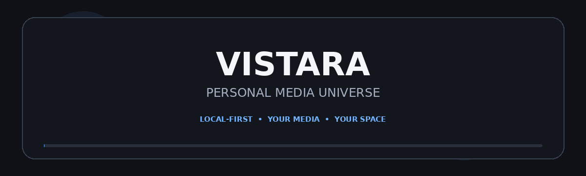

### Your media. Your space. Your universe.

**VISTARA** is a planned local-first entertainment hub for organising and enjoying your personal collection of movies, TV shows, music, photos and more — from one beautifully designed place.

## ✨ What is VISTARA?

VISTARA aims to bring your personal media library together in one unified experience. Browse your collection, keep track of what you're watching, play your music, explore your photos and manage your libraries without depending on a mandatory cloud account.

> **Design principle:** Your media stays yours. Core library features are designed around local access and user control.

## 🎬 Planned Features

| Area | What it aims to provide |
|---|---|
| **Dashboard** | Continue Watching, recently added media, activity and library overview |
| **Cinema** | Movie browsing, artwork, collections, details and watch progress |
| **TV Shows** | Series, seasons, episodes and per-episode progress |
| **Music Studio** | Tracks, artists, albums, playlists, queue and Now Playing |
| **Photo Studio** | Timeline, albums, folders and immersive photo viewing |
| **Media Player** | Playback controls, subtitles, audio tracks and resume support |
| **Library Manager** | Folder-based libraries, scanning, metadata and missing-file handling |
| **Settings** | Appearance, playback, metadata, media engine and privacy controls |
| **Backup & Recovery** | Back up application data and restore it when needed |

*Features are part of the project plan; availability depends on implementation progress.*

## 🧭 Product Principles

- **Local-first:** designed to work with media stored on your PC.
- **No mandatory login:** open the application without creating an account.
- **Privacy-minded:** no mandatory cloud upload or telemetry.
- **Original-file safety:** never modify or delete original media without explicit permission.
- **One library, multiple experiences:** desktop and browser interfaces are intended to share the same local backend.
- **Honest functionality:** unfinished features should be clearly identified, never presented as working.

## 🛠️ Planned Technology Stack

| Layer | Planned technology |
|---|---|
| Frontend | React, TypeScript, Vite |
| UI styling | Tailwind CSS |
| Backend | C#, ASP.NET Core |
| Desktop host | WPF, WebView2 |
| Database | SQLite, Entity Framework Core |
| Media inspection / processing | FFmpeg, FFprobe |
| Realtime updates | SignalR |
| Testing | xUnit, Vitest, Playwright |

The final versions and dependencies should be selected and pinned during implementation. This stack describes the intended architecture, not a claim that every component is already implemented.

## 🖥️ Experience & Design Direction

VISTARA is being designed as a premium desktop media workspace:

- Dark and light themes.
- Customisable accent colour.
- Clean, well-structured layouts.
- Consistent spacing and typography.
- Smooth, purposeful animations and micro-interactions.
- Responsive grids and resizable desktop layouts.
- Accessible keyboard interactions.
- No gradients.

The goal is a cinematic experience that remains practical, fast and comfortable for everyday use.

## 🗺️ Development Roadmap

- [ ] **Phase 1 — Foundation:** repository, backend, database, API and security
- [ ] **Phase 2 — Frontend:** application shell, navigation, dashboard and themes
- [ ] **Phase 3 — Library Engine:** scanning, file analysis, metadata and search
- [ ] **Phase 4 — Cinema & Playback:** movies, TV shows, player and subtitles
- [ ] **Phase 5 — Music & Gallery:** music library, playlists and photo experience
- [ ] **Phase 6 — Desktop & System:** WPF host, background tasks, backup and recovery
- [ ] **Phase 7 — Release:** testing, optimisation, installer and documentation

## 🔒 Privacy & Safety

The intended design keeps the application local by default:

- Bind local services to loopback unless a separately secured network mode is deliberately designed.
- Restrict file access to folders the user has selected.
- Validate paths and process arguments.
- Keep secrets out of frontend code and logs.
- Make metadata-provider internet access optional.
- Ask before destructive file operations.
- Keep original media files untouched by default.

## 🚀 Getting Started

VISTARA is currently in the planning / development stage. Setup and run instructions will be added when the repository contains a working implementation.

Once available, this section will include:

1. Prerequisites
2. Installation
3. First-run library setup
4. Running browser mode
5. Running desktop mode
6. Build and test commands

## 🧪 Quality Goals

Before a stable release, the project should be checked for:

- Functional correctness across all major modules.
- Database integrity and migration safety.
- Media playback compatibility on supported configurations.
- Recovery from interrupted scans and jobs.
- Local API and filesystem security.
- High-DPI and window-resize behaviour.
- Keyboard accessibility and reduced-motion support.
- Installer, update and uninstall behaviour.

## 🤝 Contributing

Contribution guidelines, coding standards, issue templates and pull-request instructions will be added as the repository matures.

For now, keep changes modular, documented and covered by tests where practical.

## 📄 License

A license has not yet been selected. Until one is added to the repository, all rights remain with the project owner; do not assume the code is open-source or reuse it under an unstated license.

---

**VISTARA**  
*Personal Media Universe*

Made to bring your personal media world together.

