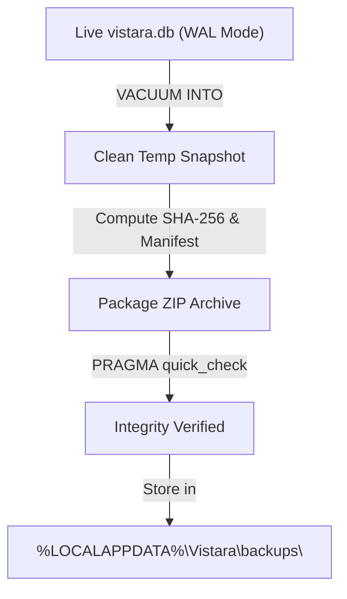

# VISTARA — Backup & Disaster Recovery Guide

## SQLite VACUUM INTO • Retention Policies • Zero-Downtime Restores

<p align="center">
  
</p>

<p align="center">
  
</p>

---

## 1. Backup Architecture Overview

Because VISTARA is a local-first platform, protecting the SQLite database containing your libraries, watch history, playlists, and metadata is paramount.

Rather than taking raw file copies (which can corrupt active databases under WAL mode), VISTARA uses SQLite's transactional `VACUUM INTO` command:

```sql
VACUUM INTO '{temp_snapshot_path}';
```

### Why `VACUUM INTO`?
- **Zero-Downtime:** The running application does not need to pause or stop.
- **Consistent Snapshot:** Produces an isolated, defragmented SQLite database file containing all transactions committed up to the exact millisecond of execution.
- **Compact Size:** Unused free pages are eliminated, resulting in minimum file size.



---

## 2. Backup Archive Structure

Each backup snapshot is packaged into a timestamped ZIP archive stored in:
`%LOCALAPPDATA%\Vistara\backups\Vistara_Backup_{yyyyMMdd_HHmmss}.zip`

Inside each archive:
- `vistara.db`: The sanitized SQLite database snapshot.
- `manifest.json`: Metadata document containing:
  - VISTARA version
  - Machine installation ID
  - Timestamp (UTC)
  - Table counts (Movies, Shows, Tracks, Photos, Playlists)
  - SHA-256 checksum of `vistara.db`

---

## 3. Creating a Backup

### Via the User Interface
1. Navigate to **Settings** in the sidebar.
2. Select the **Backup & Recovery** tab.
3. Click **Create Backup Snapshot**.
4. The snapshot will be generated, verified, and displayed in the backup history list.

### Via REST API
```powershell
Invoke-RestMethod -Uri "http://127.0.0.1:5178/api/v1/backups" `
    -Method POST `
    -Headers @{ "X-Vistara-CSRF" = $csrfToken } `
    -Body '{"type": 1, "notes": "Pre-upgrade backup"}' `
    -ContentType "application/json"
```

---

## 4. Automated Retention Policy

VISTARA manages backup storage using a grandfather-father-son retention algorithm:
- **Daily Backups:** Retains the last 7 daily snapshots.
- **Weekly Backups:** Retains 4 weekly snapshots (one per week).
- **Monthly Backups:** Retains 12 monthly snapshots.
- Expired backup archives are automatically purged after successful verification of the newest snapshot.

---

## 5. Backup Verification

Before any backup is considered valid, VISTARA executes a two-phase integrity check:
1. **ZIP CRC32 & SHA-256 Validation:** Confirms the archive has not suffered bit rot or truncation.
2. **SQLite Integrity Check:** Opens the extracted snapshot in a temporary sandbox and executes:
   ```sql
   PRAGMA quick_check;
   ```
   Ensures B-tree structures, indexes, and pages are healthy.

---

## 6. Restoring from a Backup

### Automatic Restore via Settings UI
1. Open **Settings > Backup & Recovery**.
2. Locate the desired backup snapshot in the history table.
3. Click **Restore**.
4. VISTARA will:
   - Terminate active background jobs.
   - Close SQLite connection pools.
   - Replace `%LOCALAPPDATA%\Vistara\vistara.db` with the verified snapshot.
   - Refresh the database context and trigger an application reload.

### Manual Disaster Recovery Procedure
If the application cannot start due to OS reinstallation or filesystem failure:
1. Locate your latest backup archive in `%LOCALAPPDATA%\Vistara\backups\`.
2. Extract `vistara.db` from the ZIP archive.
3. Copy `vistara.db` to `%LOCALAPPDATA%\Vistara\vistara.db`.
4. Delete any lingering `vistara.db-wal` or `vistara.db-shm` files in that folder.
5. Launch `VISTARA.exe` or `START_VISTARA.bat`. VISTARA will automatically initialize with your restored media catalog.

> [!TIP]
> Always keep at least one recent backup snapshot stored on an external USB drive or cloud backup solution for complete disaster immunity.

---

## 7. Media Location Recovery & Relinking

In addition to database snapshots, VISTARA includes automated media location recovery via the **Media Integrity Monitor**:
- **Volume Disconnections:** Unmounted USB drives never trigger media deletion. When re-attached, files return to healthy status automatically.
- **Drive Migration (Drive Letter Changes):** If an external drive letter changes (e.g., from `E:\` to `F:\`), the Media Integrity Recovery Assistant scans connected volumes for matching candidate files.
- **Candidate Scoring:** Candidates are ranked using exact byte size matching (weight: 70%) and filename substring/Levenshtein similarity (weight: 30%).
- **1-Click Relinking:** Clicking **Apply Relink** updates the database path, re-verifies the cryptographic fingerprint, and preserves all user metadata, custom posters, and playback history.

---

*VISTARA — Personal Media Universe © 2026. Built with precision for Windows.*
