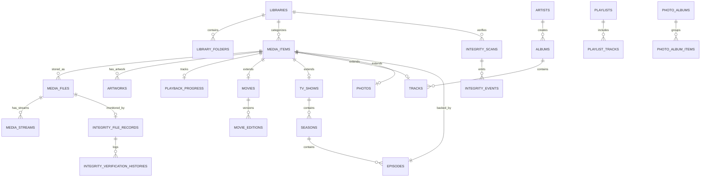

# VISTARA — Database Documentation & Schema Specification

## SQLite • Entity Framework Core • Full-Text Search (FTS5)

<p align="center">
  
</p>

<p align="center">
  
</p>

---

## 1. Database Architecture & Settings

VISTARA uses an embedded **SQLite** database managed via Microsoft Entity Framework Core 8.0.

### Engine Configuration & Pragmas
```sql
PRAGMA journal_mode = WAL;          -- Write-Ahead Logging for high concurrent read/write
PRAGMA synchronous = NORMAL;         -- Optimized commit durability without disk stalls
PRAGMA foreign_keys = ON;            -- Referential integrity enforcement
PRAGMA temp_store = MEMORY;          -- Temporary indexes stored in RAM
PRAGMA cache_size = -64000;          -- 64MB memory page cache
```

### Storage Location
- Windows Path: `%LOCALAPPDATA%\Vistara\vistara.db`
- WAL File: `%LOCALAPPDATA%\Vistara\vistara.db-wal`
- Shared Memory: `%LOCALAPPDATA%\Vistara\vistara.db-shm`

> [!NOTE]
> Write-Ahead Logging (WAL) ensures background library scanning and metadata ingestion never block active media playback or UI navigation queries.

---

## 2. Entity-Relationship Schema



---

## 3. Table Schemas

### 3.1 Library Tables

#### `Libraries`
| Column | Type | Constraints | Description |
| :--- | :--- | :--- | :--- |
| `Id` | TEXT (Guid) | PRIMARY KEY | Unique library identifier |
| `Name` | TEXT | NOT NULL | Display name (e.g. Movies, TV Shows) |
| `Type` | INTEGER | NOT NULL | Enum: Movies(1), TVShows(2), Music(3), Photos(4), Custom(5) |
| `Description` | TEXT | NULL | Optional description notes |
| `Icon` | TEXT | NULL | Lucide icon identifier |
| `AutoScanEnabled` | INTEGER (bool)| NOT NULL, DEFAULT 1 | Whether scheduled scans are enabled |
| `ScanIntervalMinutes`| INTEGER | NOT NULL, DEFAULT 60 | Interval in minutes between scans |
| `CreatedAtUtc` | TEXT | NOT NULL | Record creation timestamp |
| `UpdatedAtUtc` | TEXT | NULL | Last modification timestamp |

#### `LibraryFolders`
| Column | Type | Constraints | Description |
| :--- | :--- | :--- | :--- |
| `Id` | TEXT (Guid) | PRIMARY KEY | Unique folder identifier |
| `LibraryId` | TEXT (Guid) | NOT NULL, FK -> Libraries(Id) ON DELETE CASCADE | Associated library |
| `Path` | TEXT | NOT NULL | Canonical absolute Windows path |
| `IsMonitored` | INTEGER (bool)| NOT NULL, DEFAULT 1 | Filesystem change watcher active |
| `LastScannedUtc` | TEXT | NULL | Last successful folder scan |
| `IsAccessible` | INTEGER (bool)| NOT NULL, DEFAULT 1 | Whether directory currently exists |

---

### 3.2 Media & Stream Tables

#### `MediaItems`
Base polymorphic record representing any catalog entry.
| Column | Type | Constraints | Description |
| :--- | :--- | :--- | :--- |
| `Id` | TEXT (Guid) | PRIMARY KEY | Global media item GUID |
| `LibraryId` | TEXT (Guid) | NOT NULL, FK -> Libraries(Id) | Owning library |
| `Type` | INTEGER | NOT NULL | MediaType: Movie(1), Episode(2), Track(3), Photo(4), Video(5) |
| `Title` | TEXT | NOT NULL | Display title |
| `OriginalTitle` | TEXT | NULL | Native or non-English title |
| `Overview` | TEXT | NULL | Plot summary or caption (auto-enriched from OMDB/Cinemeta) |
| `ReleaseDate` | TEXT | NULL | Release timestamp |
| `CommunityRating` | REAL | NULL | Rating score (0.0 - 10.0) |
| `IsFavourite` | INTEGER (bool)| NOT NULL, DEFAULT 0 | User favorite flag |
| `IsInWatchlist` | INTEGER (bool)| NOT NULL, DEFAULT 0 | Watchlist marker |
| `PrimaryArtworkId`| TEXT (Guid) | NULL, FK -> Artworks(Id) | Primary poster or cover art |
| `BackdropArtworkId`| TEXT (Guid)| NULL, FK -> Artworks(Id) | Horizontal backdrop art |

#### `Artworks`
Stores posters, covers, and backdrops from local extraction or online metadata engines:
| Column | Type | Constraints | Description |
| :--- | :--- | :--- | :--- |
| `Id` | TEXT (Guid) | PRIMARY KEY | Artwork GUID |
| `MediaItemId` | TEXT (Guid) | NOT NULL, FK -> MediaItems(Id) | Parent media item |
| `Type` | INTEGER | NOT NULL | Poster(1), Backdrop(2), Banner(3), Thumbnail(4) |
| `FilePath` | TEXT | NULL | Cached file path on local disk |
| `SourceUrl` | TEXT | NULL | Remote origin URL (OMDB / Cinemeta) |
| `Width` | INTEGER | NULL | Pixel width |
| `Height` | INTEGER | NULL | Pixel height |

#### `MediaFiles`
Physical files linked to media items.
| Column | Type | Constraints | Description |
| :--- | :--- | :--- | :--- |
| `Id` | TEXT (Guid) | PRIMARY KEY | File identifier |
| `MediaItemId` | TEXT (Guid) | NOT NULL, FK -> MediaItems(Id) | Parent media item |
| `Path` | TEXT | NOT NULL | Canonicalized absolute disk path |
| `FileName` | TEXT | NOT NULL | Filename with extension |
| `FileSizeBytes` | INTEGER | NOT NULL | Exact size in bytes |
| `ContainerFormat`| TEXT | NULL | Container (mp4, mkv, flac, etc.) |
| `VideoCodec` | TEXT | NULL | Video codec (h264, hevc, av1, etc.) |
| `AudioCodec` | TEXT | NULL | Audio codec (aac, flac, mp3, etc.) |
| `DurationSeconds`| REAL | NOT NULL | Duration in seconds |
| `BitrateKbps` | INTEGER | NULL | Total file bitrate in kbps |
| `Width` | INTEGER | NULL | Frame width in pixels |
| `Height` | INTEGER | NULL | Frame height in pixels |
| `FrameRate` | REAL | NULL | Frames per second |
| `Hash` | TEXT | NULL | Quick xxHash/SHA256 for duplicate check |
| `IsMissing` | INTEGER (bool)| NOT NULL, DEFAULT 0 | Set if disk is temporarily disconnected |

#### `MediaStreams`
Streams extracted via FFprobe (video, audio, subtitles).
| Column | Type | Constraints | Description |
| :--- | :--- | :--- | :--- |
| `Id` | TEXT (Guid) | PRIMARY KEY | Stream identifier |
| `MediaFileId` | TEXT (Guid) | NOT NULL, FK -> MediaFiles(Id) ON DELETE CASCADE | Parent file |
| `StreamIndex` | INTEGER | NOT NULL | FFprobe stream index (0, 1, 2...) |
| `StreamType` | INTEGER | NOT NULL | 1: Video, 2: Audio, 3: Subtitle |
| `Codec` | TEXT | NOT NULL | Codec identifier (e.g. subrip, aac) |
| `Language` | TEXT | NULL | ISO 639-2 language code (eng, spa) |
| `Title` | TEXT | NULL | Stream title (e.g. Commentary, 5.1 Surround)|
| `Channels` | INTEGER | NULL | Audio channel count |
| `SampleRate` | INTEGER | NULL | Audio sample rate in Hz |
| `IsDefault` | INTEGER (bool)| NOT NULL, DEFAULT 0 | Default track marker |

---

### 3.3 Cinema & Television Tables

#### `Movies` & `MovieEditions`
- `Movies`: Holds `Director`, `Writers`, `Cast`, `Tagline`, `RuntimeMinutes`, and foreign key to `MediaItems`.
- `MovieEditions`: Enables multiple versions (e.g. 1080p, 4K Remux, Extended Cut) to link to a single `MovieId` and specific `MediaFileId`.

#### `TVShows`, `Seasons`, & `Episodes`
- `TVShows`: Connects to `MediaItems`, holding `Status`, `Network`, `Cast`.
- `Seasons`: Holds `SeasonNumber`, `Title`, `Overview`, and poster artwork.
- `Episodes`: Links to `MediaItems`, with `EpisodeNumber`, `AirDate`, `IntroStartSeconds`, `IntroEndSeconds`, `CreditsStartSeconds`.

---

### 3.4 Music & Gallery Tables

- `Artists`: `Name`, `Biography`, `Country`, `Genres`.
- `Albums`: `Title`, `ReleaseYear`, `Genre`, `TotalTracks`, FK to `Artists`.
- `Tracks`: `TrackNumber`, `DiscNumber`, `DurationSeconds`, `Lyrics` (synced `.lrc` text), `ReplayGainTrackGain`, FK to `Albums` and `MediaItems`.
- `Playlists` & `PlaylistTracks`: User playlists with ordered track positions.
- `Photos`: `CameraMake`, `CameraModel`, `LensModel`, `ApertureFNumber`, `ShutterSpeed`, `IsoSpeed`, `FocalLengthMm`, `Orientation`, `DateTakenUtc`.

---

### 3.5 Media Integrity Monitor Tables

#### `IntegrityScans`
Tracks discrete execution runs of library integrity verification.
| Column | Type | Constraints | Description |
| :--- | :--- | :--- | :--- |
| `Id` | TEXT (Guid) | PRIMARY KEY | Unique scan execution GUID |
| `LibraryId` | TEXT (Guid) | NULL, FK -> Libraries(Id) | Optional specific library filter |
| `ScanType` | INTEGER | NOT NULL | IntegrityScanType: Incremental(1), FullHash(2), QuickVerify(3) |
| `Status` | INTEGER | NOT NULL | IntegrityScanStatus: Pending(1), Running(2), Paused(3), Completed(4), Failed(5), Cancelled(6) |
| `StartedAtUtc` | TEXT | NOT NULL | Scan start timestamp |
| `CompletedAtUtc` | TEXT | NULL | Scan completion timestamp |
| `TotalFilesDiscovered` | INTEGER | NOT NULL, DEFAULT 0 | Total files identified in scope |
| `FilesVerified` | INTEGER | NOT NULL, DEFAULT 0 | Verified file counter |
| `FilesHealthy` | INTEGER | NOT NULL, DEFAULT 0 | Count of pristine, matched files |
| `FilesModified` | INTEGER | NOT NULL, DEFAULT 0 | Count of files modified unexpectedly |
| `FilesMissing` | INTEGER | NOT NULL, DEFAULT 0 | Count of deleted or missing files |
| `FilesCorrupted` | INTEGER | NOT NULL, DEFAULT 0 | Count of corrupted or truncated media |
| `FilesUnreadable` | INTEGER | NOT NULL, DEFAULT 0 | Files with I/O or permission lock errors |
| `FilesDriveDisconnected`| INTEGER | NOT NULL, DEFAULT 0 | Files located on unmounted volumes |
| `TotalBytesScanned` | INTEGER (Int64)| NOT NULL, DEFAULT 0 | Aggregated bytes read for verification |
| `DurationMs` | INTEGER (Int64)| NOT NULL, DEFAULT 0 | Execution duration in milliseconds |
| `ErrorMessage` | TEXT | NULL | Unhandled exception description if failed |
| `TriggeredBy` | TEXT | NOT NULL, DEFAULT 'Manual' | Scan trigger: 'Manual', 'Scheduled', 'BackgroundWatcher' |

#### `IntegrityFileRecords`
Stores current health status and cryptographic fingerprints for every media file.
| Column | Type | Constraints | Description |
| :--- | :--- | :--- | :--- |
| `Id` | TEXT (Guid) | PRIMARY KEY | Unique record GUID |
| `MediaFileId` | TEXT (Guid) | NOT NULL, FK -> MediaFiles(Id) ON DELETE CASCADE | Associated media file |
| `LibraryId` | TEXT (Guid) | NOT NULL, FK -> Libraries(Id) | Parent library |
| `FilePath` | TEXT | NOT NULL | Canonical absolute path on disk |
| `FileSizeBytes` | INTEGER (Int64)| NOT NULL | Recorded byte length |
| `Sha256Hash` | TEXT | NULL | Full or sampled SHA-256 hex string |
| `LastModifiedUtc` | TEXT | NOT NULL | Filesystem last-write timestamp |
| `LastVerifiedUtc` | TEXT | NOT NULL | Timestamp of latest verification pass |
| `Status` | INTEGER | NOT NULL | IntegrityFileStatus: Healthy(1), Modified(2), Missing(3), Corrupted(4), Unreadable(5), DriveDisconnected(6) |
| `ContainerStatus` | TEXT | NULL | FFprobe container diagnosis |
| `HasAudioStream` | INTEGER (bool)| NOT NULL, DEFAULT 0 | Verified audio stream presence |
| `HasVideoStream` | INTEGER (bool)| NOT NULL, DEFAULT 0 | Verified video stream presence |
| `DurationSeconds` | REAL | NOT NULL, DEFAULT 0 | Verified media duration |
| `ErrorMessage` | TEXT | NULL | Detailed failure diagnosis if problematic |
| `VerificationStrategy` | INTEGER | NOT NULL | VerificationStrategy: SmartIncremental(1), FullHash(2), HeaderAndTail(3) |

#### `IntegrityVerificationHistories`
Append-only audit trail tracking modifications, hash changes, and relinking events.
| Column | Type | Constraints | Description |
| :--- | :--- | :--- | :--- |
| `Id` | TEXT (Guid) | PRIMARY KEY | Unique history entry GUID |
| `IntegrityFileRecordId` | TEXT (Guid) | NOT NULL, FK -> IntegrityFileRecords(Id) | Monitored file record |
| `VerifiedAtUtc` | TEXT | NOT NULL | Historical verification timestamp |
| `PreviousHash` | TEXT | NULL | Prior SHA-256 fingerprint |
| `CurrentHash` | TEXT | NULL | Newly computed SHA-256 fingerprint |
| `PreviousSizeBytes`| INTEGER (Int64)| NOT NULL, DEFAULT 0 | Prior byte size |
| `CurrentSizeBytes` | INTEGER (Int64)| NOT NULL, DEFAULT 0 | Newly measured byte size |
| `PreviousStatus` | INTEGER | NOT NULL | Prior status enum |
| `CurrentStatus` | INTEGER | NOT NULL | New status enum |
| `ResultSummary` | TEXT | NULL | Human-readable explanation of change |

#### `IntegrityEvents`
System-wide security and corruption incident log for the dashboard.
| Column | Type | Constraints | Description |
| :--- | :--- | :--- | :--- |
| `Id` | TEXT (Guid) | PRIMARY KEY | Event GUID |
| `TimestampUtc` | TEXT | NOT NULL | Incident timestamp |
| `EventType` | INTEGER | NOT NULL | IntegrityEventType: ScanStarted(1), ScanCompleted(2), FileCorrupted(3), FileMissing(4), FileModified(5), DriveDisconnected(6), FileRelinked(7) |
| `Severity` | TEXT | NOT NULL | 'Info', 'Warning', 'Error', 'Critical' |
| `Title` | TEXT | NOT NULL | Event headline |
| `Description` | TEXT | NOT NULL | Full event context and diagnostics |
| `FilePath` | TEXT | NULL | Relevant path if file-specific |
| `MediaFileId` | TEXT (Guid) | NULL | Linked media file GUID |
| `Resolved` | INTEGER (bool)| NOT NULL, DEFAULT 0 | Whether issue has been addressed |

---

## 4. Full-Text Search (FTS5) Table

```sql
CREATE VIRTUAL TABLE IF NOT EXISTS MediaSearchIndex USING fts5(
    MediaItemId UNINDEXED,
    Title,
    OriginalTitle,
    Subtitle,
    ArtistOrCreator,
    AlbumOrSeries,
    Genres,
    Tags,
    Overview,
    tokenize = 'unicode61 remove_diacritics 2'
);
```

### Search Query Optimization
```sql
SELECT MediaItemId, bm25(MediaSearchIndex, 5.0, 3.0, 1.0, 2.0, 2.0, 1.0, 1.0, 0.5) AS Rank
FROM MediaSearchIndex
WHERE MediaSearchIndex MATCH @Query
ORDER BY Rank
LIMIT 50;
```

---

*VISTARA — Personal Media Universe © 2026. Built with precision for Windows.*
