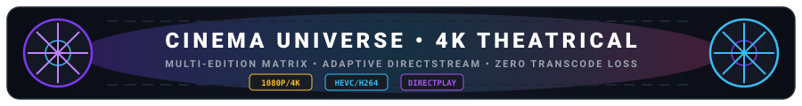
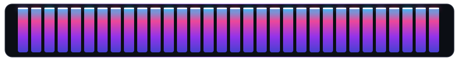

# VISTARA — Release Notes

## Version 1.5.0 • Holographic Wave, Motion System v2 & Studio Player Suite

  

  

---

### 1. Release Overview

**VISTARA — Personal Media Universe (v1.5.0)** introduces a stunning aesthetic and sensory upgrade featuring the new **Holographic Wave** brand identity, the **Motion System v2** animation framework across all pages, the studio-mastered **Seductive French Siren** startup vocal, a **7-color Dynamic Accent Palette**, native **Picture-in-Picture (PiP)** video multitasking, and interactive **Playback Speed Cycling**:

- **Holographic Wave Brand Emblem & Multi-Res Windows Icon:**
  - **Prismatic Holographic Vector (`logo.svg`):** Redesigned signature logo featuring a rainbow iridescent V vector, concentric celestial orbit rings, aperture diamond beacon, and obsidian acrylic squircle canvas.
  - **Multi-Tier Windows Icon (`VISTARA.ico`):** 7 embedded resolution layers (`16px`, `24px`, `32px`, `48px`, `64px`, `128px`, `256px`) with 1-click desktop and project root shortcuts (`VISTARA.lnk`).
  - **Universal Favicon Integration:** Synchronized favicon ICO and SVG assets across all public and `wwwroot` endpoints.

- **VISTARA Motion System v2 (Animations Across All Pages):**
  - **10 GPU-Accelerated Micro-Animations:**
    1. **Page Enter Transition (`.page-enter`):** 420ms spring fade-and-slide (`translateY(14px)` + scale + subtle blur clearance) on every navigation tab change.
    2. **Staggered Item Cascade (`.stagger-item`):** Sequential `40ms` interval fade-up animations across media grids, ensuring natural visual hierarchy on page load.
    3. **Card Shimmer & Elevation Lift (`.vistara-card`):** High-precision hover lift (`translateY(-4px)`), cyan border illumination, and reflective 600ms specular light-sweep across cards.
    4. **Applied Universally Across the App:** Cinema movie cards, TV series cards, Music track & album items, Playlists & Smart Mixes, Dashboard stats & Continue Watching cards, Watchlist items, and Favourites.
    5. **Skeleton Shimmer Loaders (`.skeleton`):** Smooth 1.6s shimmering pulse for zero-layout-shift data fetching states.
    6. **Magnetic Sidebar Indicators (`.nav-item`, `.nav-active`):** Cyan luminescent left bar spring-expands smoothly on the active navigation destination.
    7. **Tactile Button Feedback (`.btn-press`):** Micro scale-down snap (`0.94x`) on user clicks.
    8. **Badge Pop Animation (`.badge-pop`):** Elastic entrance scale bounce for tags and resolution markers.
    9. **Ambient Spotlight Sweep (`.spotlight-sweep`):** Soft luminous wave traversing modal backdrops and panels.
    10. **Accessibility Guard:** Full `prefers-reduced-motion: reduce` compliance automatically clamps animation timings to 0.01ms.

- **Studio Seductive French Siren Startup Vocal ("Vistara"):**
  - **Studio Neural Mastering:** Mastered multilingual neural vocal synthesis (`fr-FR-VivienneMultilingualNeural`, rate `-22%`, pitch `-1Hz`) delivering a sensual, non-generic whisper.
  - **Acoustic DSP Chain:** Conditioned with a 220Hz proximity warmth EQ (`+3.5dB`), silky 9kHz air highshelf (`+6dB`), and Haas stereo spatializer (`22ms` delay) with brickwall limiting.
  - **Independent Voice Whisper Toggle (Settings > Appearance):** Dedicated toggle with a `French Siren` badge allowing users to enable or mute the vocal whisper independently from the synthesized chord profile, persisted in `localStorage` (`vistara_startup_voice`).

- **Dynamic 7-Color Accent Palette (Settings > Appearance):**
  - Expanded beyond Glacier Blue to include 7 vibrant, solid accent themes:
    - ❄️ **Glacier Blue** (`#38BDF8`)
    - 💜 **Violet** (`#A78BFA`)
    - 🌹 **Rose** (`#FB7185`)
    - 🌟 **Gold** (`#FBBF24`)
    - 🌿 **Emerald** (`#34D399`)
    - 🍊 **Orange** (`#FB923C`)
    - 🌸 **Coral Pink** (`#F472B6`)
  - Live interactive color pills with real-time CSS variable cascading (`--accent-color`, `--color-accent`, `--accent-hover`) and automatic settings persistence.

- **Picture-in-Picture (PiP) Video Multitasking:**
  - Added native HTML5 Picture-in-Picture toggle button to the Video Player Modal (`PictureInPicture2` icon).
  - Enables floating video playback while continuing to browse libraries, explore music, or manage settings.

- **Interactive Playback Speed Cycling (Audio & Video):**
  - **MiniPlayer Audio Speed Badge:** 1-click speed button cycling through `0.75x`, `1x`, `1.25x`, `1.5x`, and `2x` speeds for audiobooks, podcasts, and songs.
  - **Video Player Modal:** Dedicated speed calibration menu for fine-tuned viewing pacing.

---

## Version 1.4.1 • Cyber-Horizon Acoustic Identity & Startup Customization

  

  

---

### 1. Release Overview

**VISTARA — Personal Media Universe (v1.4.1)** elevates the app's acoustic identity and startup sequence with an all-new default sound signature and user-customizable audio profiles:

- **Cyber-Horizon Default Startup Sound (PlayStation / Sci-Fi Synthwave):**
  - **Futuristic Shimmer Riser:** Swept bandpass filter rising from 120Hz to 2400Hz (Q=3.2) building anticipation into the visual monolith lock-in.
  - **Dmaj9 / F#sus Warm Poly-Synth Chord:** Lush multi-voice detuned sawtooth and triangle oscillators with dynamic 24dB resonant lowpass sweep.
  - **Deep Orbital Sub-Drop:** Resonant 96Hz to 36Hz exponential sub-harmonic rumble with smooth saturation shaping.
  - **Crystalline High Bells:** Sparkle glass chimes at 1480Hz, 2217Hz, and 2960Hz.
  - **Studio Soft Female Whisper ("Vistara"):** Air-filtered studio female voice whisper floating smoothly over the chord decay.

- **Startup Sound Profile Selector (Settings > Appearance):**
  - Choice of **5 curated Web Audio acoustic profiles** with 1-click live preview:
    1. **Cyber-Horizon (Default):** PlayStation / Sci-Fi Synthwave warmth with orbital sub-drop and whisper.
    2. **Cinema Ta-Dum:** Dolby / Netflix theatrical dual sub-bass slam and orchestral brass.
    3. **Acoustic Zen:** Apple / Mac harmonic glass chime chord with warm wooden mallet transient.
    4. **Retro Cyberpunk:** Blade Runner / 80s Moog detuned sawtooth brass blast with tape echo.
    5. **Cosmic Ambient:** Interstellar / Deep Space binaural celestial drone and planetary rumble.
  - Complete state persistence across reloads via `vistara_intro_sound_profile`.

- **Startup Screen Visual Polish:**
  - **Horizontal Side Orbital Flanks:** Repositioned the cybernetic HUD telemetry rings from top/bottom to horizontal side orbital flanks (`translateX(-260px)` and `translateX(260px)`).
  - **Laser Bead Flare & Warp Dive Outward Spread:** Expanded dive mechanics (`±480px`) plunging smoothly through the monolith emblem into the dashboard.

- **High-Definition Vector Squircle Brand Emblem:**
  - Integrated the redesigned vector emblem into `assets/logo.svg`, `assets/logo-512.png`, the `index.html` favicon, the `README.md` header, and the Now Playing status pill.

---

## Version 1.4.0 • Apple Music Experience & Precision Artwork Engine

  

  

---

## 1. Release Overview

**VISTARA — Personal Media Universe (v1.4.0)** introduces a landmark aesthetic transformation inspired by Apple Music, alongside a resilient multi-tier album artwork extraction and auto-import pipeline, and synchronized Hinglish lyrics subtitles:

- **Apple Music-Inspired UI Transformation:**
  - **Living Fluid Mesh Aura:** Ambient chromatic blooms (`#FA2D48` Apple Crimson, `#38BDF8` Sky Teal, `#818CF8` Cosmic Indigo) drifting organically in the backdrop with `blur-[120px]` and 35-50% saturation boost.
  - **Frosted Acrylic Glass Materials (`.apple-glass`, `.apple-glass-panel`):** Multi-layered translucent acrylic surfaces with `backdrop-filter: blur(28px) saturate(190%)`, hairline border illumination (`rgba(255, 255, 255, 0.12)`), and specular inset highlights.
  - **macOS Apple Music Floating Sidebar:** Frosted acrylic panel with rounded pill navigation items, subtle hover glow, active selection indicators, and responsive collapse/expand (`Ctrl+B`).
  - **Apple Search Capsule:** Centered floating pill search bar with hairline frosted glass, real-time query clearance, and keyboard shortcut pill (`Ctrl+K`).
  - **Bottom Player Island Deck:** Floating translucent dock featuring artwork thumbnail, title & artist subtitle, centered transport controls with solid radiant white circular play button, dynamic volume slider, and instant click-to-expand.
  - **Borderless Synced Lyrics Canvas:** Apple Music-style lyrics typography with pure radiant white active typography (`drop-shadow-[0_2px_16px_rgba(255,255,255,0.45)]`), dynamic blurring (`blur-[0.35px]`) on past/upcoming lines at 35-45% opacity, and smooth spring auto-centering scroll.

- **Bilingual Romanized Hinglish Lyrics Subtitles:**
  - **Positioned Directly Underneath Main Text:** Romanized Hinglish translations render inline beneath each synced lyric line (`main text ke neche`) with staggered slide-in kinetic typography.
  - **Zero-Latency Client-Side Transliterator:** Instant Devanagari-to-Hinglish engine handling schwa deletion, Urdu/Persian nukta consonants (`क़`, `ख़`, `ग़`, `ज़`, `फ़`, `ड़`, `ढ़`), matras, and 50+ Bollywood vernacular overrides.
  - **Side-by-Side Lyrics Auto-Reveal:** Dynamically slides into view 2-3 seconds after audio playback begins beside the animated Cassette Tape or Vinyl turntable, with 1-click manual toggle and persistence.

- **Robust Multi-Tier Album Artwork Extraction & Auto-Import (100% Coverage):**
  - **FFmpeg Frame Decode Pipeline:** Replaced direct stream copy with complete frame decoding (`-vframes 1 -q:v 2 -y`), eliminating container codec failures on embedded PNG and WEBP cover images.
  - **Folder-Level Local Discovery:** Automatically scans directory trees for existing artwork candidates (`cover.jpg`, `folder.jpg`, `album.jpg`, `front.jpg`).
  - **Multi-Tier Search Hierarchy:** Fallback ladder: Artist + Album → Clean Album Title alone (vital for Bollywood OSTs / Compilations with multiple artists) → Artist + Track Title → Clean Track Title alone.
  - **Scanner-Level Auto-Import:** During background library scans, tracks without embedded artwork immediately trigger the multi-tier online engine and link artwork IDs across Tracks, Albums, and Artists.
  - **Verified 100% Artwork Resolution:** Complete coverage achieved across all 416 library tracks (`Missing Art: 0 / 416`).

---

## Version 1.3.0 • The Sound, Motion & Branding Overhaul

  

  

---

## 1. Release Overview

**VISTARA — Personal Media Universe (v1.3.0)** introduces a landmark visual, motion, and acoustic overhaul:
- **Redesigned VISTARA Brand Logo ("The Prismatic Apex & Celestial Horizon"):** Precision vector emblem featuring dual interlocking aerodynamic blades with specular chamfer cuts, an orbital celestial horizon ring, and an illuminated aperture star beacon across the app and browser favicon.
- **Hyper-Dynamic Cinematic Startup Screen:** Interactive 3D mouse parallax particle field, real-time Cyber-HUD telemetry banner, laser assembly, "Ta-Dum" acoustic shockwave blast, anamorphic lens flare flash, laser lead bead progress bar (0% to 100%), and hyper-dive camera warp transition into the dashboard.
- **Bilingual Romanized Hinglish Lyrics Subtitles:** Zero-latency client-side Devanagari transliterator and backend translation pipeline displaying natural Romanized Hinglish subtitles directly below the main lyric line (`main text ke neche`) with glassmorphism elevation, beat-responsive equalizer bars, and spring kinetic auto-scroll.
- **Side-by-Side Synced Lyrics Beside Cassette Tape:** Auto-reveals 2.0s after audio playback starts (or immediately if already past 2s) with 1-click manual toggle and responsive dual-column expansion.
- **Beat-Synced 360° Chromatic Rainbow Visualizers with Delta-Time Physics:** Full 360-degree saturated chromatic spectrum across `AudioVisualizer` and `MiniVisualizer`, delta-time normalization (`performance.now()`) for micro-stutter-free 60/120/144Hz displays, and ambient equalizer wave during pauses.
- **Cassette Tape Motion Physics:** Restored continuous physical spool rotation (`@keyframes cassetteSpoolRotate`), progressive magnetic tape spool radius dynamics, and soundwave expanding ping rings (`@keyframes soundwavePing`).
- **High-Resolution Album Cover Art Auto-Import:** Multi-source cover art engine fetching up to 3000x3000px artwork from Cover Art Archive, MusicBrainz, and Deezer CDN.
- **Picture Vault Complete Decommissioning:** Decommissioned legacy Picture Vault from all sidebar navigation, routes, and database models.

---

## Version 1.2.0 • Media Integrity Monitor & Unified Dual-Tone Design

  

  

---

## 1. Release Overview

**VISTARA — Personal Media Universe (v1.2.0)** brings enterprise-grade media library safety, a unified dual-tone aesthetic, and advanced audio interaction:
- **Production-Ready Media Integrity Monitor (v1.0):** Continuous background verification, streaming SHA-256 fingerprinting, deep corruption detection via FFprobe & FFmpeg, disconnected drive safety guards, automated recovery candidate discovery, and CSV/JSON health reporting.
- **Unified Dual-Tone Design System (v2.1):** Single, distraction-free visual identity pairing **Midnight Charcoal surfaces (`#10151B` / `#151A21` / `#1B222B`)** with **Electric Teal (`#35C6B0`)** accenting. Zero gradients app-wide.
- **Interactive Audio Scrubber Engine:** Micro-equalizer jumping indicators, energy shimmer beam glide across active fill tracks, dynamic soundwave halo with breathing pulse on scrubber knobs, and floating timestamp tooltips.
- **Music Studio 3 View Modes:** Switch between Detailed Table View (`Table`), Power-Browsing Compact Rows (`Compact`), and Card Grid View (`Grid`).

---

## 2. What's New in Version 1.2.0

### 🛡️ Media Integrity Monitor (v1.0)
* **Streaming SHA-256 Fingerprinting:**
  * Memory-efficient buffered streaming hashing (`64KB` buffers) for multi-gigabyte 4K Blu-ray remuxes and lossless FLAC files.
  * Smart incremental vs. full verification strategies: verifies size and timestamps before re-hashing unchanged assets.
* **Multi-Tier Corruption Detection:**
  * Categorizes files into confirmed corruption, zero-byte truncated containers, unreadable filesystem blocks, missing streams, and temporary access errors.
  * Deep container inspection via `FFprobe` and optional direct stream decode tests via `FFmpeg`.
* **Disconnected Drive Preservation:**
  * External HDDs, SSDs, and network drives are detected at the root volume level.
  * Disconnected drives are assigned `DriveDisconnected` status—**never marked as deleted or missing**. All metadata, poster artwork, and watch progress are strictly preserved.
* **Recovery Assistant & Secure Relinking:**
  * Candidate discovery algorithm matches moved or renamed files by filename similarity and exact byte size.
  * 1-click candidate relinking with strict path security validation (`IPathSecurityValidator`) preventing directory traversal.
* **Real-Time SignalR Health Push:**
  * Live scan progress telemetry, instant issue detection notifications, and scan completion broadcasts.
* **Exportable Health Reports:**
  * Comprehensive CSV and JSON report exports detailing healthy, modified, missing, corrupted, and disconnected media.

### 🎨 Unified Dual-Tone Design System (v2.1)
* **Single Color Identity:** Pure Midnight Charcoal (`#10151B` base, `#151A21` card surface, `#242A36` borders) accented exclusively with solid Electric Teal (`#35C6B0`).
* **Absolute Zero Gradients:** Removed all linear and radial gradients in favor of high-contrast solid matte finishes.
* **Simplified Settings:** Settings → Appearance now locks directly to Cinematic Dark and Electric Teal, eliminating competing theme palettes.
* **Distraction-Free Layout:** Removed legacy Anime catalog from sidebar and navigation, focusing entirely on personal Cinema, TV Shows, Music, and Photos.

### 🎶 Music Studio & Player Polish
* **Listing View Mode Selector:**
  * **Table View (`Table`):** Comprehensive columns with Title, Artist, Album, Duration, and sorting headers.
  * **Compact View (`Compact`):** Streamlined rows optimized for rapid navigation through 400+ tracks.
  * **Card Grid View (`Grid`):** Cover artwork grid with hover play overlays.
* **Animated Audio Progress Bar:**
  * 3-bar jumping mini equalizer indicator next to the current playback time.
  * Dynamic soundwave ping and pulse ripple radiating from the scrubber thumb while playing.
  * Energy shimmer glide running continuously through the played track fill.
  * Floating seek tooltip displaying precise target timestamps on hover.

---

## 3. Version 1.1.0 • Feature & Performance Update

  

  

---

## 1. Release Overview

**VISTARA — Personal Media Universe (v1.1.0)** delivers groundbreaking performance, visual enhancements, and playback optimizations:
- Full **Cinema Universe Uncapped 100+ Grid** with live search filtering and dynamic page sizing.
- **Automated Online Theatrical Posters & Plot Synopses** powered by OMDB & Cinemeta open catalogs.
- **Beat-Synced 60 FPS Rainbow Audio Visualizers** (Spectrum Bars & Cosmic Rainbow Embers) that react to sub-bass kick dynamics.
- **0% CPU DirectStream Remuxing** for MKV files and hardware-accelerated 10-bit YUV420P NVENC transcoding.
- **1-Click Standalone Desktop Launcher** (`VISTARA.exe`) with automated background API daemon orchestration.

---

## 2. What's New in Version 1.1.0

  

### 🎬 Cinema Universe & Poster Engine
* **Uncapped 100+ Library Grid:** Removed the default 24-movie limitation. Cinema now displays all movies (100+ titles) smoothly with instant scrolling.
* **Dynamic Page Size Control:** Seamlessly switch between *All (100+)*, *200*, *48*, or *24* items per page with an interactive footer "Load More" button.
* **Live In-Page Instant Search:** Filter titles immediately as you type directly in the Cinema header bar.
* **Direct-Card Hover Play:** Hover over any movie poster to launch playback instantly with a single click.
* **Online Poster & Synopsis Engine:**
  * Automated lookup from OMDB and Cinemeta open catalogs without requiring API keys or account registration.
  * Integrated **3-Tab Poster Picker Modal**: choose from *Online Suggestions*, *Local File Upload*, or *Direct Image URL*.
  * **⚡ Auto Fetch Posters Bulk Tool**: One-click command to automatically fetch and apply high-res posters and plot summaries across the entire library.
  * **Scanner Auto-Enrichment**: Newly indexed movies and TV shows are automatically enriched with online posters and synopses during background scanning.

### 🎵 Music Studio & Beat-Synced Visualizers

  

* **Beat-Synced Rainbow Spectrum Bars:**
  * 32-to-48 frequency bands mapped across a full 310° rainbow spectrum with per-bar gradient lighting.
  * Floating white laser caps with physical gravity deceleration and sub-bass velocity kicks.
* **Cosmic Rainbow Embers:**
  * 360-degree rainbow hue particle cloud reacting to rhythm and transient audio spikes.
  * Synaptic glowing constellation web lines connecting active particle clusters.
  * Expanding central sonic shockwaves pulsing on heavy sub-bass beats.
* **LRCLIB Synced Karaoke Lyrics:**
  * Real-time line-by-line synchronized scrolling with glowing accent lighting and click-to-seek playback.
  * Offline SQLite lyrics caching for instant subsequent playback.

### ⚡ Media Engine & Streaming Optimizations
* **0% CPU DirectStream Remuxing:**
  * On-the-fly container remuxing (`-c:v copy -c:a aac -f mp4 pipe:1`) for `.mkv` files containing compatible H.264 video.
  * Zero video decoding or encoding required, resulting in ~10ms startup and 0% CPU consumption.
* **Hardware-Accelerated 10-bit YUV420P Transcoding:**
  * Resolved NVENC pixel format constraints by dynamically mapping 10-bit HEVC sources to `-pix_fmt yuv420p` with `-preset p2`.
  * Guarantees smooth, jitter-free playback of 10-bit x265 HDR content across all web engines.
* **Self-Healing Audio Recovery:**
  * Automatic fallback to pristine 320 kbps stream when encountering non-standard container tags or corrupted embedded picture blocks.

### 🚀 Standalone 1-Click Launch Experience
* **Headless Executable (`VISTARA.exe`):** Launches silently as a Windows GUI Subsystem (`WinExe`) with zero flashing console windows.
* **Automated Daemon Management:** Verifies loopback port `5178` and spins up the backend API process automatically if not active.
* **Zero Configuration:** Ready out-of-the-box with embedded SQLite WAL database and full offline playback capability.

---

## 3. Version 1.0.0 • Initial Milestone Archive

### Core Platform Architecture
- Modular monolith backend built on ASP.NET Core 8 and Entity Framework Core 8.
- Native WPF desktop host with evergreen Microsoft Edge WebView2 runtime.
- High-performance SQLite database with Write-Ahead Logging (WAL) and FTS5 full-text search.
- Multi-threaded non-blocking library scanner with missing-file safety guards.
- Transparent Zero-Login security barrier bound strictly to `127.0.0.1:5178`.

---

## 4. Supported Codecs & Containers

| Media Type | Formats & Codecs |
| :--- | :--- |
| **Video Containers** | MP4, MKV, WebM, MOV, AVI, MPEG-TS, VOB, WMV, FLV |
| **Video Codecs** | H.264 (AVC), H.265 (HEVC 8/10-bit), VP8, VP9, AV1, MPEG-2, VC-1 |
| **Audio Formats** | FLAC (16/24-bit 192kHz), MP3 (320k), WAV, AAC, M4A, ALAC, OGG, OPUS, WMA, AIFF |
| **Photo Formats** | JPEG, PNG, WebP, GIF, BMP, TIFF, Apple HEIC, AVIF, RAW (CR2, NEF, ARW) |
| **Subtitle Formats** | Embedded SRT/ASS/SSA, External SRT, W3C WebVTT |

---

*VISTARA — Personal Media Universe © 2026. Built with precision for Windows.*
