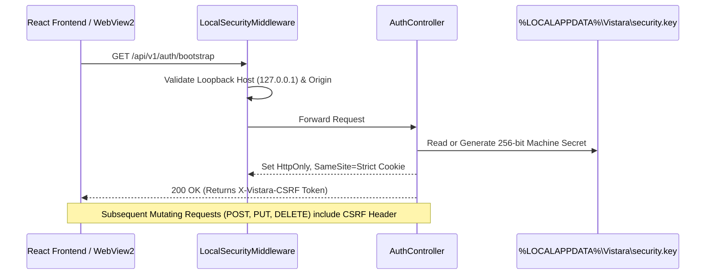

# VISTARA — Security Architecture & Threat Model

## Local-First Security • Zero-Login Architecture • Filesystem Defense

<p align="center">
  
</p>

<p align="center">
  
</p>

---

## 1. Zero-Login Threat Model & Trust Boundary

Traditional web media servers rely on username/password forms or third-party cloud accounts. In a desktop-first personal media platform, credentials introduce unnecessary friction and potential attack vectors.

VISTARA replaces login screens with a **transparent cryptographic local boundary**:



1. **Loopback IP Binding:**
   - Kestrel strictly binds to loopback interface `127.0.0.1:5178`. It never listens on wildcard interfaces (`0.0.0.0`) or connects to local area network (LAN) interfaces.
2. **Per-Installation Secret:**
   - On first execution, VISTARA generates a 256-bit cryptographically secure random installation secret saved to:
     `%LOCALAPPDATA%\Vistara\security.key`
   - Windows file permissions are restricted to the current user's security identifier (SID).
3. **Session Bootstrapping:**
   - When the React frontend loads, it calls `GET /api/v1/auth/bootstrap`.
   - The server validates loopback origin and generates a short-lived cryptographically signed session token delivered in an `HttpOnly`, `SameSite=Strict` cookie.
   - A synchronized anti-CSRF token is returned in the response payload for inclusion in mutating HTTP headers.

> [!IMPORTANT]
> The loopback socket binding (`127.0.0.1:5178`) ensures that no external network entity, malware on other network nodes, or public internet scanners can reach the VISTARA server.

---

## 2. Request Validation Middleware

All incoming HTTP requests pass through `LocalSecurityMiddleware` before reaching ASP.NET Core controllers:

### 2.1 Host Header Validation
Prevents DNS rebinding attacks where an external malicious site attempts to map a domain to `127.0.0.1`.
- **Allowed Hosts:** `127.0.0.1`, `127.0.0.1:5178`, `localhost`, `localhost:5178`.
- Any request with a mismatched `Host` header is immediately rejected with `403 Forbidden`.

### 2.2 Origin & Referer Validation
Prevents Cross-Site Request Forgery (CSRF) originating from other browser tabs:
- The `Origin` or `Referer` header must match:
  - `http://127.0.0.1:*`
  - `http://localhost:*`
  - `app://` (WPF WebView2 embedded host origin)
- If an untrusted origin is detected on state-changing requests, the request is terminated with `403 Forbidden`.

### 2.3 CSRF Protection
- All `POST`, `PUT`, `DELETE`, and `PATCH` requests must provide the `X-Vistara-CSRF` header matching the active session token.

---

## 3. Filesystem Security & Path Traversal Prevention

The `PathSecurityValidator` prevents directory traversal attacks (e.g. `../../Windows/System32` or malicious symlinks):

### Validation Algorithm
```csharp
public static bool IsPathSafe(string requestedPath, IEnumerable<string> allowedBaseFolders)
{
    // 1. Resolve canonical path without relative tokens
    string canonical = Path.GetFullPath(requestedPath);

    // 2. Prohibit root drive or system directory enumeration
    if (canonical.Equals(Path.GetPathRoot(canonical), StringComparison.OrdinalIgnoreCase))
        return false;

    // 3. Ensure canonical path is strictly contained within registered library folders
    foreach (var baseFolder in allowedBaseFolders)
    {
        string canonicalBase = Path.GetFullPath(baseFolder);
        if (canonical.StartsWith(canonicalBase, StringComparison.OrdinalIgnoreCase))
            return true;
    }

    // 4. Also permit application data cache directory
    string appData = Path.GetFullPath(Environment.GetFolderPath(Environment.SpecialFolder.LocalApplicationData) + @"\Vistara");
    return canonical.StartsWith(appData, StringComparison.OrdinalIgnoreCase);
}
```

---

## 4. Subprocess Execution Defense

When invoking FFmpeg or FFprobe:
- `UseShellExecute = false` is strictly enforced.
- No `cmd.exe` or `powershell.exe` wrappers are invoked.
- Arguments are passed as individual structured array parameters rather than concatenated strings, preventing parameter and shell injection.

---

## 5. Security Response Headers

All HTTP responses emitted by VISTARA include standard defensive headers:
```http
X-Content-Type-Options: nosniff
X-Frame-Options: DENY
Referrer-Policy: strict-origin-when-cross-origin
Content-Security-Policy: default-src 'self'; script-src 'self'; style-src 'self' 'unsafe-inline'; img-src 'self' data: blob: https:; media-src 'self' blob:; connect-src 'self' ws://127.0.0.1:* http://127.0.0.1:* https://lrclib.net;
```

---

## 6. Media Integrity & Relinking Path Validation

The Media Integrity Monitor enforces strict security boundaries during automated and manual file relinking:
1. **`IPathSecurityValidator` Enforcement:**
   - Prevents path traversal sequences (`..`, `/`, `\`).
   - Forbids relinking to Windows system roots (`C:\Windows`, `C:\Program Files`, `C:\System Volume Information`).
   - Restricts file extensions exclusively to known media types (`.mp4`, `.mkv`, `.mp3`, `.flac`, `.jpg`, etc.).
2. **Read-Only Media Pipeline:**
   - Hashing is performed via read-only file streams (`FileAccess.Read`, `FileShare.ReadWrite`).
   - The monitor never writes to, modifies, remuxes, or deletes user media binaries under any circumstance.
3. **Cryptographic Fingerprint Storage:**
   - Full SHA-256 digests provide tamper detection against unauthorized modifications or disk data degradation.

---

*VISTARA — Personal Media Universe © 2026. Built with precision for Windows.*
