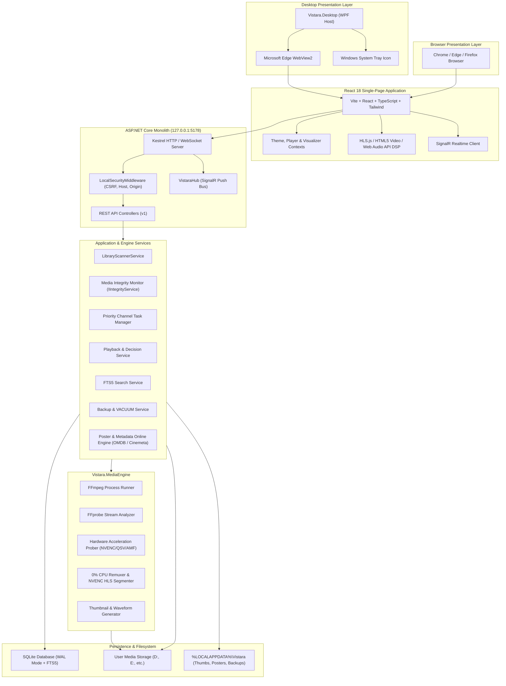
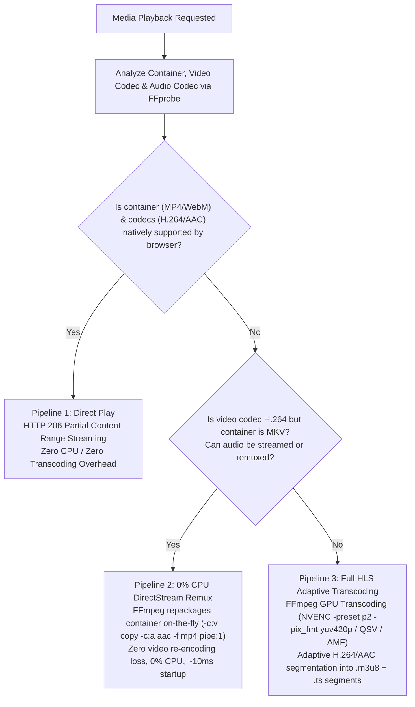
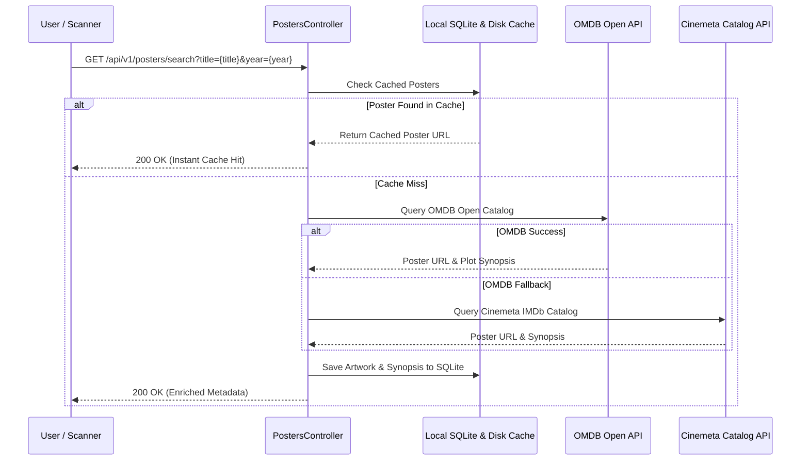
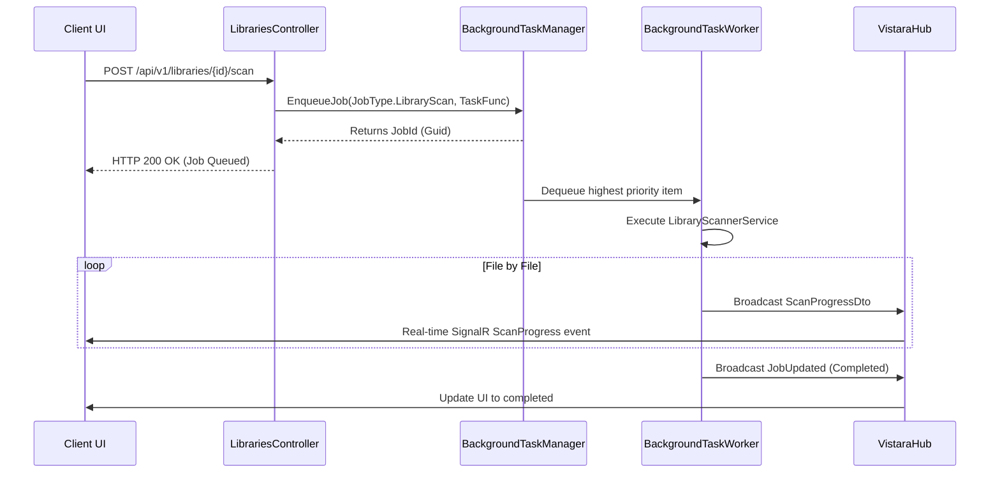
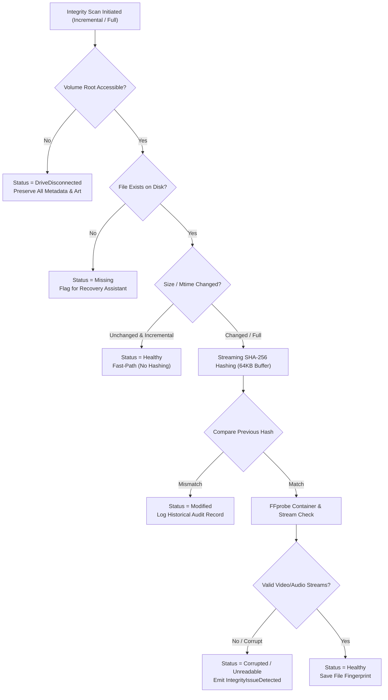

# VISTARA — Technical Architecture Specification

## Personal Media Universe • Architecture Blueprint

<p align="center">
  
</p>

<p align="center">
  
</p>

---

## 1. System Topology & High-Level Architecture

VISTARA is designed as a single-process backend coupled with dual presentation hosts (WPF desktop shell and modern web browsers). All persistent state is stored locally on the user's workstation.



> [!NOTE]
> All media streaming, scanning, and metadata lookups are non-blocking and thread-isolated. The frontend communicates with the backend via REST endpoints and a real-time SignalR push notification bus.

---

## 2. Playback Pipeline Architecture

<p align="center">
  
</p>

VISTARA dynamically evaluates client browser media capabilities to determine the most efficient delivery pipeline:



### Pipeline Details:
1. **Direct Play (HTTP 206 Partial Content):**
   - High-throughput byte-range seeking directly off local disk.
   - Native pass-through for MP4, WebM, and M4V files with H.264/AV1/VP9 and AAC/MP3 audio.
2. **0% CPU DirectStream Remuxing:**
   - For Matroska (`.mkv`) files containing standard H.264 video, FFmpeg executes a lossless container repackaging:
     ```bash
     ffmpeg -hide_banner -loglevel error -ss {offset} -i {file} -map 0:v:0 -map 0:a:{audioIdx}? -c:v copy -c:a aac -b:a 192k -movflags frag_keyframe+empty_moov+default_base_moof -f mp4 pipe:1
     ```
   - Video stream is copied byte-for-byte without CPU decompression, delivering instantaneous start times and zero frame drops.
3. **Hardware-Accelerated Transcoding (NVENC / QSV / AMF):**
   - Used when handling 10-bit HEVC x265, VC-1, MPEG-2, or legacy codecs.
   - Converts 10-bit color profiles smoothly using `-pix_fmt yuv420p` with the low-latency `-preset p2` flag, completely avoiding GPU pixel-format incompatibilities.

---

## 3. Web Audio DSP & Beat-Synced Visualizer Architecture

```mermaid
flowchart LR
    AudioElem["HTML5 Audio Element"] --> SourceNode["MediaElementAudioSourceNode"]
    SourceNode --> EQ10["10-Band BiquadFilter Graph (32Hz - 16kHz)"]
    EQ10 --> CompNode["DynamicsCompressorNode (Loudness Normalizer)"]
    CompNode --> Analyser["AnalyserNode (fftSize=256, smoothing=0.85)"]
    Analyser --> Dest["AudioContext.Destination (Speakers/Headphones)"]
    
    Analyser -.-> FrequencyData["Uint8Array Frequency & Time-Domain Data"]
    FrequencyData --> Visualizers["60 FPS Canvas Renderers"]
    
    subgraph Visualizers ["Visualizer Modes"]
        Bars["Rainbow Spectrum Bars (310° Hue, Laser Caps)"]
        Embers["Cosmic Rainbow Embers (Particle Dynamics, Sonic Shockwaves)"]
        Wave["Liquid Wave (Spline Ribbons)"]
        Halo["Radial Halo (360° Artwork Pulse)"]
        VU["Dual Stereo VU Meters (Ballistic Inertia)"]
    end
```

<p align="center">
  
</p>

VISTARA features an audiophile-grade Web Audio API digital signal processing graph connected directly to real-time HTML5 60 FPS `<canvas>` renderers:



> [!TIP]
> **Sub-Bass Kick Tracking:**
> The visualizer engine isolates frequency bins $0 \rightarrow 3$ ($20 \text{ Hz} \rightarrow 90 \text{ Hz}$). When energy surpasses the dynamic threshold, it triggers kinetic velocity surges in Cosmic Embers and gravitational acceleration on Rainbow Spectrum floating peak caps.

---

## 4. Online Poster & Metadata Enrichment Pipeline



---

## 5. Background Task Processing Architecture

Long-running operations (such as library scanning, thumbnail generation, and database vacuuming) are decoupled from the HTTP request cycle using an in-memory priority queue based on .NET `System.Threading.Channels.Channel<T>`.



---

## 6. Database Concurrency & FTS5 Full-Text Search

### SQLite Engine Configuration
- **Journal Mode:** Write-Ahead Logging (`WAL`). Allows concurrent readers while a single background worker writes without database locking.
- **Synchronous Flag:** `NORMAL` for high write throughput during multi-thousand file scans.
- **Foreign Key Constraints:** Explicitly enabled via `PRAGMA foreign_keys = ON;`.

### Full-Text Search 5 (FTS5) Virtual Table
To deliver sub-millisecond search across hundreds of thousands of media entries, VISTARA utilizes an FTS5 virtual table:

```sql
CREATE VIRTUAL TABLE IF NOT EXISTS MediaSearchIndex USING fts5(
    MediaItemId UNINDEXED,
    Title,
    OriginalTitle,
    Subtitle,
    ArtistOrCreator,
    AlbumOrSeries,
    Genres,
    Tags,
    Overview,
    tokenize = 'unicode61 remove_diacritics 2'
);
```

When files are scanned or modified, VISTARA triggers asynchronous synchronization with `MediaSearchIndex`. The search query uses BM25 relevance ranking:

$$\text{Score} = \text{bm25}(MediaSearchIndex, 5.0, 3.0, 1.0, 2.0, 2.0, 1.0, 1.0, 0.5)$$

---

## 7. Security Architecture

1. **Loopback Locking:** Kestrel strictly binds to IP address `127.0.0.1` (loopback adapter).
2. **Host Header Validation:** Rejects any request where `Host` header is not `127.0.0.1` or `localhost`, preventing DNS rebinding attacks.
3. **Origin Validation:** Enforces that `Origin` or `Referer` headers match `http://127.0.0.1:*`, `http://localhost:*`, or `app://` (WPF WebView2).
4. **Anti-CSRF Tokens:** State-changing API endpoints (`POST`, `PUT`, `DELETE`) require the `X-Vistara-CSRF` header matching the session token.
5. **Path Traversal Guard:** All file and thumbnail routes validate paths against canonicalized library folders or the application data directory using `PathSecurityValidator`.

---

## 8. Media Integrity Monitor Architecture

The **Media Integrity Monitor (`IIntegrityService`)** provides continuous, read-only protection of the user's media collection:



### Key Architectural Safeguards:
1. **Disconnected Drive Rule:** Disconnected external drives (USB HDDs/SSDs) or unmounted network shares are classified as `DriveDisconnected`—**never** marked as deleted or missing.
2. **Streaming SHA-256:** Uses asynchronous 64KB buffer streams to compute checksums without loading entire files into memory.
3. **Recovery Candidate Scoring:** Missing files can be relinked automatically or manually. Candidate discovery ranks filesystem matches by exact byte length match (score 70) and filename Levenshtein/substring similarity (score 30).
4. **Zero Media Modification:** The integrity service operates in strictly read-only mode with respect to media binaries.

---

## 9. Unified Dual-Tone Design Architecture (v2.1)

VISTARA strictly adheres to a unified dual-tone design language:
- **Surfaces:** Deep Midnight Charcoal (`#10151B` base, `#151A21` surface, `#1B222B` raised panels, `#222B35` cards).
- **Borders & Dividers:** Subtle high-contrast borders (`#242A36` primary, `#303A45` secondary).
- **Signature Accent:** Solid Electric Teal (`#35C6B0`, hover `#2BA895`).
- **Typography:** Inter / system-ui sans-serif with JetBrains Mono for durations, hashes, and bitrates.
- **Strict Visual Discipline:** Zero gradients, zero neon glassmorphism, zero competing accent palettes.

---

*VISTARA — Personal Media Universe © 2026. Built with precision for Windows.*
