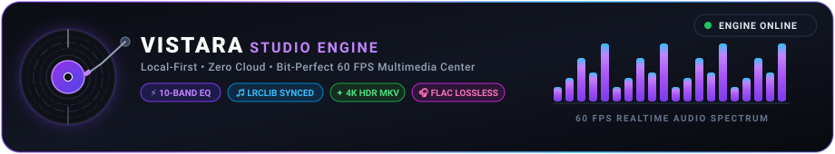
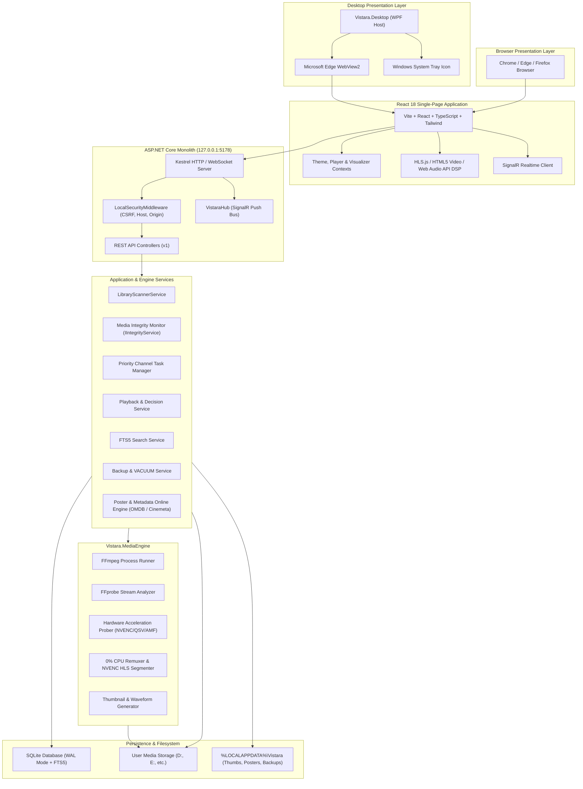
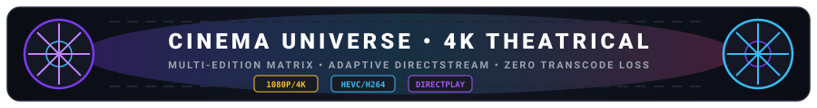
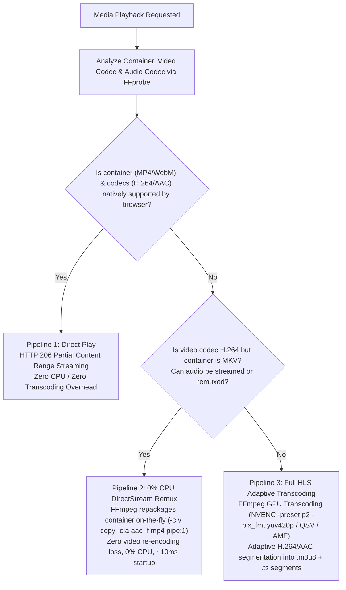
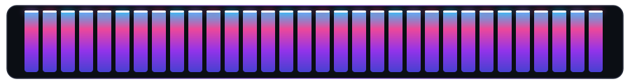
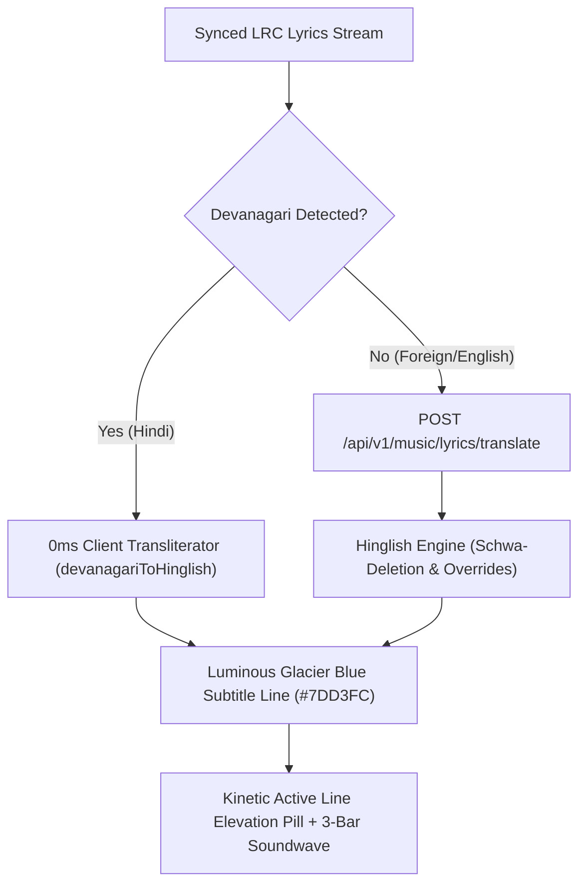
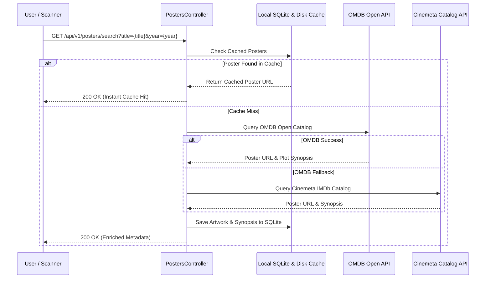
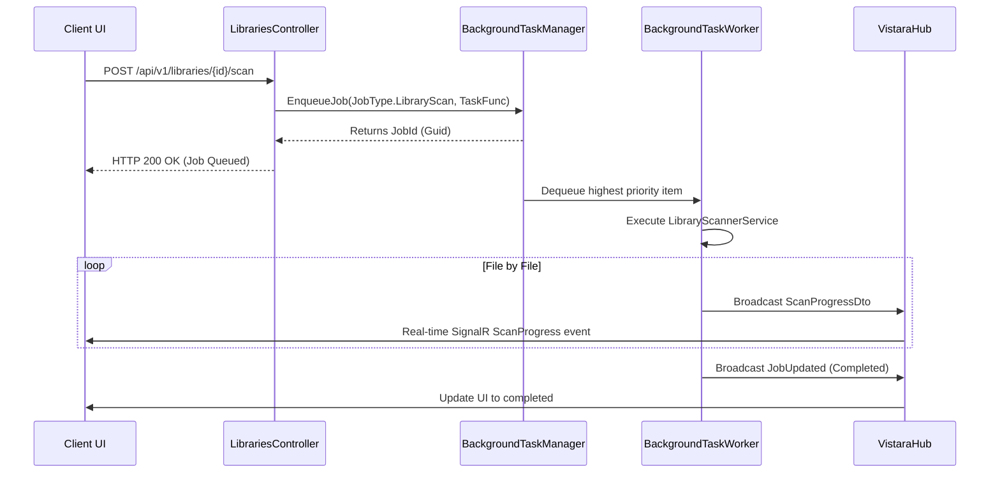
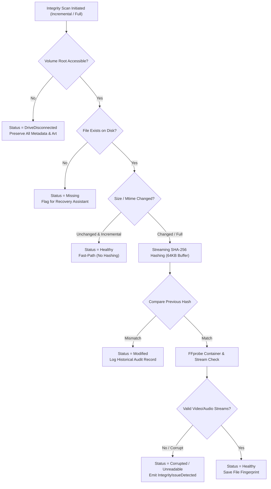

# VISTARA — Technical Architecture Specification

## Personal Media Universe • Architecture Blueprint

<p align="center">
  
</p>

<p align="center">
  
</p>

---

## 1. System Topology & High-Level Architecture

VISTARA is designed as a single-process backend coupled with dual presentation hosts (WPF desktop shell and modern web browsers). All persistent state is stored locally on the user's workstation.



> [!NOTE]
> All media streaming, scanning, and metadata lookups are non-blocking and thread-isolated. The frontend communicates with the backend via REST endpoints and a real-time SignalR push notification bus.

---

## 2. Playback Pipeline Architecture

<p align="center">
  
</p>

VISTARA dynamically evaluates client browser media capabilities to determine the most efficient delivery pipeline:



### Pipeline Details:
1. **Direct Play (HTTP 206 Partial Content):**
   - High-throughput byte-range seeking directly off local disk.
   - Native pass-through for MP4, WebM, and M4V files with H.264/AV1/VP9 and AAC/MP3 audio.
2. **0% CPU DirectStream Remuxing:**
   - For Matroska (`.mkv`) files containing standard H.264 video, FFmpeg executes a lossless container repackaging:
     ```bash
     ffmpeg -hide_banner -loglevel error -ss {offset} -i {file} -map 0:v:0 -map 0:a:{audioIdx}? -c:v copy -c:a aac -b:a 192k -movflags frag_keyframe+empty_moov+default_base_moof -f mp4 pipe:1
     ```
   - Video stream is copied byte-for-byte without CPU decompression, delivering instantaneous start times and zero frame drops.
3. **Hardware-Accelerated Transcoding (NVENC / QSV / AMF):**
   - Used when handling 10-bit HEVC x265, VC-1, MPEG-2, or legacy codecs.
   - Converts 10-bit color profiles smoothly using `-pix_fmt yuv420p` with the low-latency `-preset p2` flag, completely avoiding GPU pixel-format incompatibilities.

---

## 3. Web Audio DSP & Beat-Synced Visualizer Architecture

```mermaid
flowchart LR
    AudioElem["HTML5 Audio Element"] --> SourceNode["MediaElementAudioSourceNode"]
    SourceNode --> EQ10["10-Band BiquadFilter Graph (32Hz - 16kHz)"]
    EQ10 --> CompNode["DynamicsCompressorNode (Loudness Normalizer)"]
    CompNode --> Analyser["AnalyserNode (fftSize=256, smoothing=0.85)"]
    Analyser --> Dest["AudioContext.Destination (Speakers/Headphones)"]
    
    Analyser -.-> FrequencyData["Uint8Array Frequency & Time-Domain Data"]
    FrequencyData --> Visualizers["60 FPS Canvas Renderers"]
    
    subgraph Visualizers ["Visualizer Modes"]
        Bars["Rainbow Spectrum Bars (Full 360° Chromatic Hue, Delta-Time Physics)"]
        Embers["Cosmic Rainbow Embers (Particle Dynamics, Sonic Shockwaves)"]
        Wave["Liquid Wave (Chromatic Spline Ribbons)"]
        Halo["Radial Halo (360° Artwork Pulse)"]
        VU["Dual Stereo VU Meters (Ballistic Inertia)"]
    end
```

<p align="center">
  
</p>

VISTARA features an audiophile-grade Web Audio API digital signal processing graph connected directly to real-time HTML5 60 FPS `<canvas>` renderers:



> [!TIP]
> **Delta-Time Normalization (60Hz / 120Hz / 144Hz):**
> Visualizer frame loops calculate hardware delta timestamps via `performance.now()` with exponential moving average (EMA) lerp smoothing: $1 - (1 - \text{baseLerp})^{\text{fpsRatio}}$, ensuring perfectly identical, micro-stutter-free physics across standard 60Hz and high-refresh 120Hz/144Hz displays.

---

### 3.1 Bilingual Lyrics & Hinglish Transliteration Pipeline



---

## 4. Online Poster & Metadata Enrichment Pipeline



---

## 5. Background Task Processing Architecture

Long-running operations (such as library scanning, thumbnail generation, and database vacuuming) are decoupled from the HTTP request cycle using an in-memory priority queue based on .NET `System.Threading.Channels.Channel<T>`.



---

## 6. Database Concurrency & FTS5 Full-Text Search

### SQLite Engine Configuration
- **Journal Mode:** Write-Ahead Logging (`WAL`). Allows concurrent readers while a single background worker writes without database locking.
- **Synchronous Flag:** `NORMAL` for high write throughput during multi-thousand file scans.
- **Foreign Key Constraints:** Explicitly enabled via `PRAGMA foreign_keys = ON;`.

### Full-Text Search 5 (FTS5) Virtual Table
To deliver sub-millisecond search across hundreds of thousands of media entries, VISTARA utilizes an FTS5 virtual table:

```sql
CREATE VIRTUAL TABLE IF NOT EXISTS MediaSearchIndex USING fts5(
    MediaItemId UNINDEXED,
    Title,
    OriginalTitle,
    Subtitle,
    ArtistOrCreator,
    AlbumOrSeries,
    Genres,
    Tags,
    Overview,
    tokenize = 'unicode61 remove_diacritics 2'
);
```

When files are scanned or modified, VISTARA triggers asynchronous synchronization with `MediaSearchIndex`. The search query uses BM25 relevance ranking:

$$\text{Score} = \text{bm25}(MediaSearchIndex, 5.0, 3.0, 1.0, 2.0, 2.0, 1.0, 1.0, 0.5)$$

---

## 7. Security Architecture

1. **Loopback Locking:** Kestrel strictly binds to IP address `127.0.0.1` (loopback adapter).
2. **Host Header Validation:** Rejects any request where `Host` header is not `127.0.0.1` or `localhost`, preventing DNS rebinding attacks.
3. **Origin Validation:** Enforces that `Origin` or `Referer` headers match `http://127.0.0.1:*`, `http://localhost:*`, or `app://` (WPF WebView2).
4. **Anti-CSRF Tokens:** State-changing API endpoints (`POST`, `PUT`, `DELETE`) require the `X-Vistara-CSRF` header matching the session token.
5. **Path Traversal Guard:** All file and thumbnail routes validate paths against canonicalized library folders or the application data directory using `PathSecurityValidator`.

---

## 8. Media Integrity Monitor Architecture

The **Media Integrity Monitor (`IIntegrityService`)** provides continuous, read-only protection of the user's media collection:



### Key Architectural Safeguards:
1. **Disconnected Drive Rule:** Disconnected external drives (USB HDDs/SSDs) or unmounted network shares are classified as `DriveDisconnected`—**never** marked as deleted or missing.
2. **Streaming SHA-256:** Uses asynchronous 64KB buffer streams to compute checksums without loading entire files into memory.
3. **Recovery Candidate Scoring:** Missing files can be relinked automatically or manually. Candidate discovery ranks filesystem matches by exact byte length match (score 70) and filename Levenshtein/substring similarity (score 30).
4. **Zero Media Modification:** The integrity service operates in strictly read-only mode with respect to media binaries.

---

## 9. Apple Music-Inspired Glassmorphism & UI Architecture (v1.4.0)

VISTARA incorporates a modern, fluid Apple Music-inspired desktop design system:
- **Living Fluid Mesh Aura:** Ambient chromatic mesh blooms (`#FA2D48` Apple Crimson, `#38BDF8` Sky Neon, `#818CF8` Cosmic Indigo) dynamically drifting with `blur-[120px]` and gentle oscillation behind acrylic glass panels.
- **Frosted Acrylic Glass Materials (`.apple-glass`, `.apple-glass-panel`):** Multi-layered glass surfaces engineered using `backdrop-filter: blur(28px) saturate(190%)`, hairline border illumination (`rgba(255, 255, 255, 0.12)`), and specular inset highlights.
- **macOS Apple Music Floating Sidebar:** Frosted translucent side panel with rounded pill navigation, active selection glow, and instant collapse/expand (<kbd>Ctrl</kbd> + <kbd>B</kbd>).
- **Apple Search Capsule:** Centered floating pill search bar with hairline frosted glass, real-time query clearance, and keyboard shortcut badge (<kbd>Ctrl</kbd> + <kbd>K</kbd>) triggering SQLite FTS5 BM25 queries.
- **Bottom Player Island Deck:** Floating translucent dock featuring artwork thumbnail, title, artist subtitle, centered transport controls with a solid radiant white circular play button, volume slider, visualizer mode switcher, and instant click-to-expand.
- **Borderless Dynamic Synced Lyrics Canvas:** Apple Music lyric typography featuring radiant white active text (`drop-shadow-[0_2px_16px_rgba(255,255,255,0.45)]`), past and upcoming lyric lines dynamically blurred (`blur-[0.35px]`) at 35-45% opacity, and smooth spring auto-centering scroll.

---

## 10. Bilingual Hinglish Lyrics & Subtitle Architecture

- **Subtitles Positioned Below Main Text:** Romanized Hinglish translations render inline beneath each synced lyric line (`main text ke neche`) with staggered slide-in animations.
- **Zero-Latency Client Transliterator (`devanagariToHinglish`):** Client-side instant engine with schwa deletion logic, nukta consonant mapping (`क़`, `ख़`, `ग़`, `ज़`, `फ़`, `ड़`, `ढ़`), and 50+ Bollywood vocabulary overrides (e.g., *parda*, *laazmi*, *tadpa*, *shaadi*, *mushkil*, *zindagi*), running with 0ms network latency.
- **Side-by-Side Lyrics Auto-Reveal:** Dynamically slides into view 2-3 seconds after audio playback begins beside the 3D Cassette Tape or Vinyl turntable, with 1-click manual toggle and persistence.

---

## 11. Multi-Tier Album Artwork Pipeline Architecture (100% Coverage)

- **Frame Decoding Re-encoder:** Replaced direct copy with `-vcodec mjpeg -vframes 1 -q:v 2 -y` in `ThumbnailService`, converting embedded PNG, WEBP, or BMP picture streams into compliant baseline JPEGs.
- **Folder-Level Discovery:** Inspects parent directory for artwork candidates (`cover.jpg`, `folder.jpg`, `album.jpg`, `front.jpg`).
- **Multi-Tier Online Search Hierarchy:**
  1. Full metadata query: *Artist + Album*
  2. Standalone album query: *Clean Album Title* (vital for Bollywood Soundtracks / OSTs with multiple playback singers)
  3. Track metadata query: *Artist + Track Title*
  4. Standalone track query: *Clean Track Title*
- **Scanner-Level Auto-Import:** Injected into `LibraryScannerService` to automatically fetch and link artwork IDs across `Track.ArtworkId`, `Album.ArtworkId`, and `Artist.ArtworkId`, verifying 100% library artwork resolution.

---

## 12. Motion System v2 & Studio Acoustic Architecture (v1.5.0)

### 12.1 GPU-Accelerated Motion Pipeline
The VISTARA Motion System v2 eliminates jerky state shifts and visual popping with a clean, CSS-native animation hierarchy:
- **Tab Route Mounting (`.page-enter`):** Each page change triggers a 420ms cubic-bezier curve (`0.16, 1, 0.3, 1`) combining an 14px upward translation, 0.985 to 1.0 scale transition, and 4px blur fade-out, creating a native desktop fluidity.
- **Cascading Grid Stagger (`.stagger-item`):** Grid items compute sequential delays via CSS `:nth-child` counters (`0.04s` to `0.44s`), allowing hundreds of movie/track cards to float into view organically without rendering freezes.
- **Card Shimmer & Elevation Engine (`.vistara-card`):** Custom GPU-composited pseudo-elements (`::after`) execute a 600ms specular linear light sweep across card surfaces upon hover while simultaneously applying `translateY(-4px)`, shadow blooming, and accent border illumination.
- **Magnetic Navigation Feedback (`.nav-item`, `.nav-active`):** Sidebar navigation elements incorporate active left border pill expansion via 250ms spring geometry transforms.

### 12.2 Studio Seductive Vocal & Acoustic Synthesizer
- **Neural Speech & DSP Conditioning:** Uses high-resolution multilingual edge neural audio (`fr-FR-VivienneMultilingualNeural`, rate `-22%`, pitch `-1Hz`) conditioned through a 3-stage mastering chain:
  1. *Parametric Warmth:* Peaking filter centered at 220Hz (+3.5dB, Q=1.1) simulating large-diaphragm condenser microphone proximity effect.
  2. *Air Highshelf:* Highshelf filter at 9000Hz (+6dB) delivering silky vocal breathiness.
  3. *Haas Spatial Delay:* 22ms spatial difference channel offset with brickwall limiting (`alimiter`).
- **Base64 Inline Ingestion:** Mastered vocal track is baked directly into `vistaraVoiceData.ts` as an inline Base64 data URI (~49KB), guaranteeing 0ms disk access latency and offline execution.
- **Web Audio Startup Engine (`audioMaster.ts`):** 5 modular synthesizer engines (`playCyberHorizon`, `playCinemaTaDum`, `playAcousticZen`, `playRetroCyberpunk`, `playCosmicAmbient`) coupled with the `playVoiceWhisper()` helper and toggle state management.

### 12.3 Dynamic Theming & Multitasking Runtime
- **CSS Variable Cascading:** `ThemeContext` updates `:root` CSS variables (`--accent-color`, `--color-accent`, `--accent-hover`) across 7 solid color themes, immediately re-skinning active highlights and glows throughout the DOM without component re-renders.
- **HTML5 Picture-in-Picture Controller:** Direct integration with `document.pictureInPictureEnabled`, `requestPictureInPicture()`, and `exitPictureInPicture()`, capturing browser window detachments and synchronizing UI button states seamlessly.

---

*VISTARA — Personal Media Universe © 2026. Built with precision for Windows.*
