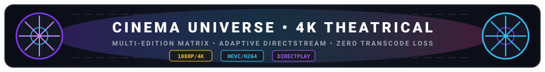
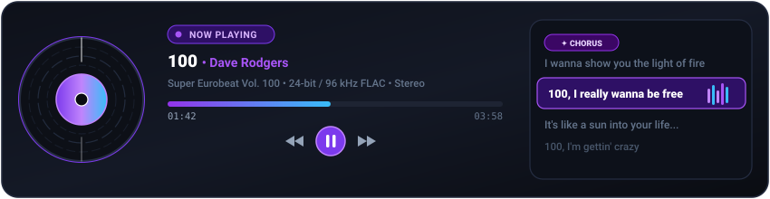
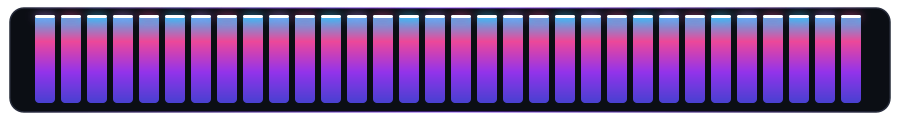

# VISTARA — User Manual

## Personal Media Universe • Version 1.0.0

  

  

---

## Table of Contents

1. [Introduction](#1-introduction)
2. [Getting Started & Standalone Operation](#2-getting-started--standalone-operation)
3. [Navigating the Interface](#3-navigating-the-interface)
4. [Media Modules](#4-media-modules)
   - [Cinema Universe & Poster Engine](#41-cinema-universe-movies)
   - [TV Series Universe](#42-television-shows)
   - [Music Studio, Equalizer & 60 FPS Visualizers](#43-music-studio)
   - [Playlists & Collections](#44-playlists)
5. [Library Management & File Scanning](#5-library-management--file-scanning)
6. [Keyboard Shortcuts Reference](#6-keyboard-shortcuts-reference)
7. [Backup & Recovery](#7-backup--recovery)

---

## 1. Introduction

Welcome to **VISTARA — Personal Media Universe**, a local-first personal entertainment and media management platform engineered for Windows 10 and 11. 

VISTARA brings together all your personal entertainment media—Movies, Television Shows, Music, and Video Collections—under a unified interface without requiring accounts, registration, cloud subscriptions, or mandatory internet connections.

### Core Principles
- **100% Local-First:** Your media, watch history, metadata, and playlists reside solely on your PC.
- **Zero-Login Experience:** No accounts, passwords, or external authentication servers. Launch the application and enter directly.
- **Filesystem Safety:** VISTARA never modifies, moves, or deletes your original media files during indexing or metadata curation.
- **Hardware-Accelerated Engine:** Ultra-low latency playback and transcoding powered by FFmpeg with GPU acceleration (NVIDIA NVENC, Intel QSV, AMD AMF, DXVA2, D3D11VA).
- **Cinematic Dark Design:** A distraction-free visual environment utilizing solid dark surfaces (`#0b0d11`, `#12151b`) and vibrant solid accents without visual clutter or gradients.

> [!NOTE]
> VISTARA binds strictly to the local loopback address (`127.0.0.1:5178`). It never opens listening ports to public networks or local area networks, ensuring your media remains strictly private.

---

## 2. Getting Started & Standalone Operation

### Standalone 1-Click Launch (`VISTARA.exe`)
Double-click **`VISTARA.exe`** directly from the root or standalone bundle directory:
- Embedded with high-resolution Windows application icons.
- Silent headless launch (`OutputType = WinExe`) with zero command prompt flashing.
- Checks local port `5178`; starts the API daemon automatically if inactive.
- Opens the native WPF WebView2 desktop container seamlessly.

> [!TIP]
> **Complete Offline Independence:**
> VISTARA works 100% offline. Once launched, you can browse, organize, play 4K HDR videos, and listen to FLAC music even with no internet connection. When connected to the internet, optional online poster/lyrics lookups run in the background.

### Alternative Launch Modes
1. **Silent Script (`VISTARA_SILENT.vbs`):** Starts the background services and GUI silently without terminal windows.
2. **Batch Launcher (`START_VISTARA.bat`):** Useful for diagnostic startup and viewing server output logs.
3. **Web Browser Mode:** Open any browser (Edge, Chrome, Firefox, Brave) and navigate to `http://127.0.0.1:5178/`.

---

## 3. Navigating the Interface

  

- **Collapsible Sidebar (Left):**
  - Toggle with <kbd>Ctrl</kbd> + <kbd>B</kbd> or the bottom chevron button.
  - Direct links to **Dashboard**, **Cinema**, **TV Shows**, **Music**, **Playlists**, **Watchlist**, **Favourites**, **Libraries**, and **Settings**.
- **Header Bar (Top):**
  - **FTS5 Global Search:** Press <kbd>Ctrl</kbd> + <kbd>K</kbd> to search across movies, shows, music tracks, artists, and albums in milliseconds.
  - **Job Monitor:** Real-time pulse indicator showing scanning and transcoding status.
  - **Security Indicator:** Verified green dot for local loopback (`127.0.0.1`).
  - **Theme Toggle:** Instant switch between Dark and Light mode.
- **Persistent Mini-Player (Bottom):**
  - Docked player deck with real-time waveform visualizer, seek bar, time display, volume attenuation slider, and queue toggles.

---

## 4. Media Modules

### 4.1 Cinema Universe (Movies)

  

- **Uncapped 100+ Grid View:** By default, Cinema displays your entire movie library (100+ items) without arbitrary 24-item pagination ceilings.
- **Dynamic Page Size Control:** Switch between *All (100+)*, *200*, *48*, or *24* per page using the responsive bottom dropdown, accompanied by a quick "Load More" pagination trigger.
- **Instant Live Search:** Filter movies in real time as you type directly in the cinema view header.
- **Direct Hover Play:** Hover over any poster card to reveal the green play button for instant one-click streaming.
- **Automated Theatrical Posters & Synopses:**
  - Auto-fetches official studio posters and plot summaries from OMDB and Cinemeta open catalogs.
  - **3-Tab Poster Picker Modal:** Click any movie and customize artwork via *Online Suggestions*, *Local File Upload*, or *Direct Image URL*.
  - **⚡ Auto Fetch Posters Tool:** Single-click bulk utility to backfill posters across all catalog items automatically.
- **First-Class Multi-Edition Support:** Multiple cuts (*1080p BluRay*, *4K UHD*, *Director's Cut*, *Extended Edition*) are automatically stacked into a single movie card with an in-player edition picker.
- **0% CPU DirectStream Remuxing:** H.264 video inside MKV files is stream-remuxed on the fly into MP4 containers with zero transcoding CPU overhead.
- **Hardware-Accelerated Transcoding:** 10-bit HEVC x265 media is hardware-transcoded via NVIDIA NVENC (`-preset p2 -pix_fmt yuv420p`), Intel QSV, or AMD AMF.

### 4.2 Television Shows
- **Series & Season Tree:** Organize TV shows into multi-season hierarchies with episode counts and banner artwork.
- **Intelligent Episode Detection:** Regex recognition for `S01E02`, `1x02`, `Season 1 Episode 2`.
- **Automated Show Synopses:** Auto-fetches series posters and plot overviews from online metadata sources.
- **Next-Episode Autoplay:** Automatically queues and prompts the next episode when the current one reaches 90% completion.

### 4.3 Music Studio

  

  

- **Lossless Audiophile Pipeline:** Native playback for FLAC, WAV, MP3, AAC, ALAC, OGG, OPUS, and AIFF with embedded ID3 and Vorbis tag extraction.
- **Vintage Cassette Tape & Vinyl Showcase:** Auto-opens on playback, featuring a realistic 3D flipping Cassette Tape (Side A front face / Side B audio metadata) with continuous physical spool rotation, magnetic tape diameter dynamics, and 1-click toggle to spinning Vinyl Record.
- **Side-by-Side Synced Lyrics:** Auto-reveals synced lyrics beside the cassette tape 2.0s after audio starts playing (or immediately if already past 2s). Includes a 1-click toggle button (`Show Lyrics` / `Lyrics: Beside Tape`) and expands the modal to a comfortable dual-column desktop view.
- **Bilingual Romanized Hinglish Subtitles:** Real-time Romanized Hinglish translations rendered directly below the main lyric line (`main text ke neche`). Uses a zero-latency client-side Devanagari transliterator (`devanagariToHinglish`) and backend translation engine, active by default.
- **High-End Kinetic Typography & Beat Animations:** Active line glassmorphism pill, dynamic 3-bar soundwave equalizer pulsing to real-time audio bass transients, subtitle slide-in animation, and smooth spring auto-scroll centering.
- **3 Listing View Modes:**
  * **Table View (`Table`):** Comprehensive columns with Title, Artist, Album, Duration, and sorting headers.
  * **Compact View (`Compact`):** High-density streamlined rows for rapid browsing through large music libraries.
  * **Card Grid View (`Grid`):** Cover artwork cards featuring hover play buttons and album titles.
  * *Your preferred view mode is saved automatically in your browser profile.*
- **High-Resolution Album Cover Art Auto-Import:** 1-click & automated artwork fetcher sourcing up to 3000x3000px artwork from Cover Art Archive, MusicBrainz, and Deezer CDN.
- **Interactive Audio Progress Bar:**
  * **Micro-Equalizer Bars:** 3 animated jumping bars next to the active timestamp display while playing.
  * **Soundwave Halo:** Dynamic breathing glow and double-ping ripple radiating from the scrubber knob during playback.
  * **Energy Shimmer Beam:** Continuous micro-gleam gliding across the played track fill.
  * **Floating Seek Tooltip:** Real-time timestamp pill following your cursor on hover.
  * **Hover Expand:** Smoothly expands track height from 4px to 6px on hover with subtle Electric Teal glow.
- **Beat-Synced 360° Chromatic Rainbow Visualizers (60/120/144 FPS):**
  1. **Rainbow Spectrum Bars (`bars`)**: Full 360-degree saturated chromatic rainbow spectrum analyzer (Red $\rightarrow$ Orange $\rightarrow$ Yellow $\rightarrow$ Green $\rightarrow$ Cyan $\rightarrow$ Blue $\rightarrow$ Purple $\rightarrow$ Magenta) with vertical neon intensity gradients, solid-white floating peak caps with gravitational fall, delta-time normalization, and an ambient equalizer wave when paused.
  2. **Cosmic Rainbow Embers (`embers`)**: 360-degree rainbow particle cloud with kinetic velocity surges reacting to sub-bass transients, synaptic glowing constellation webs, and expanding central sonic shockwaves.
  3. **Liquid Wave (`wave`)**: Chromatic rainbow spline ribbon dancing to harmonic audio dynamics.
  4. **Radial Halo (`halo`)**: 360-degree circular orbital spectrum radiating behind the album artwork, pulsing to real-time sub-bass kick energy.
  5. **Vintage Stereo VU Meter (`vu`)**: Dual analog ballistic needle meters with channel separation, needle inertia, and calibrated red danger zones (+0 dB to +3 dB).
- **10-Band Graphic Equalizer:** Studio equalizer spanning 32 Hz to 16 kHz with 8 genre presets (*Flat*, *Bass Boost*, *Treble Boost*, *Rock*, *Pop*, *Jazz*, *Classical*, *Electronic*, *Vocal Focus*).
- **LRCLIB Synced Lyrics:** Karaoke-style real-time synced lyrics with line-by-line glow highlights, auto-scrolling, and click-to-seek playback.

### 4.4 Playlists
- **Cross-Media Collections:** Build mixed playlists with music tracks, movies, or video clips.
- **One-Click Play All:** Load full playlists into active queue with shuffle support.

### 4.5 Media Health & Integrity Monitor
VISTARA protects your media library against silent bit-rot, unreadable disks, unexpected modifications, and disconnected drives:
- **Media Health Dashboard:** Access via **Media Health** in the sidebar. Displays total monitored files, healthy percentage, modified files, missing files, corrupted files, and total verified storage size.
- **Real-Time Integrity Scans:**
  * **Smart Incremental:** Verifies file size and timestamps first; only hashes modified or newly discovered files.
  * **Full Verification:** Computes full streaming SHA-256 fingerprints across every single file in the library.
  * **Quick Verify:** Fast header and stream validation via FFprobe.
- **Problem Reports & Diagnostics:**
  * View detailed error descriptions for unreadable files, truncated zero-byte files, and invalid containers.
  * Inspect historical verification audit logs comparing prior and current file hashes.
- **Disconnected Drive Safety:** External hard drives and USB SSDs that are unplugged are safely classified as `DriveDisconnected`—**never** marked as deleted or missing. Artwork, play progress, and metadata remain 100% intact.
- **Recovery Assistant:**
  * Discovers replacement candidates on connected drives by exact byte size and filename similarity.
  * Offers 1-click candidate relinking or secure manual path entry.
- **Export Health Reports:** Export your complete library health assessment in CSV or JSON format with a single click.

---

## 5. Library Management & File Scanning

  

1. Open **Libraries** in the sidebar.
2. Click **Add Library** and select the content type (Movies, TV Shows, Music).
3. Assign local Windows directory paths (e.g., `D:\Movies`, `E:\Music`).
4. Click **Scan Now** to trigger real-time directory ingestion with live SignalR progress.
5. **Auto-Metadata Enrichment:** The scanner automatically retrieves posters and synopses from OMDB & Cinemeta for newly added movies and shows.
6. **External Drive Protection:** If an external drive is detached, files are marked as `IsMissing = true` without deleting metadata or history.

---

## 6. Keyboard Shortcuts Reference

| Shortcut | Scope | Action |
| :--- | :--- | :--- |
| <kbd>Space</kbd> | Universal | Play / Pause media playback |
| <kbd>←</kbd> / <kbd>→</kbd> | Music / Video | Seek backward / forward (5s audio, 10s video) |
| <kbd>↑</kbd> / <kbd>↓</kbd> | Video Player | Increase / Decrease volume (5% steps) |
| <kbd>M</kbd> | Universal | Toggle audio mute / unmute |
| <kbd>F</kbd> / <kbd>F11</kbd> | Video / Desktop | Toggle borderless fullscreen mode |
| <kbd>Esc</kbd> | Universal | Exit fullscreen / Close modal |
| <kbd>V</kbd> | Music Player | Cycle audio visualizer modes (*Bars* $\rightarrow$ *Wave* $\rightarrow$ *Halo* $\rightarrow$ *Embers* $\rightarrow$ *VU* $\rightarrow$ *Off*) |
| <kbd>Q</kbd> | Music Player | Toggle Up Next queue drawer |
| <kbd>L</kbd> | Music Player | Toggle synchronized lyrics view |
| <kbd>S</kbd> | Music Player | Toggle shuffle mode |
| <kbd>R</kbd> | Music Player | Cycle repeat mode (*Off* $\rightarrow$ *All* $\rightarrow$ *One*) |
| <kbd>C</kbd> | Video Player | Open online subtitles search menu |
| <kbd>Ctrl</kbd> + <kbd>K</kbd> | Universal | Open global full-text search (SQLite FTS5) |
| <kbd>Ctrl</kbd> + <kbd>B</kbd> or <kbd>[</kbd> | Universal | Toggle Sidebar collapse / expand |

---

## 7. Backup & Recovery

VISTARA includes a built-in zero-risk disaster recovery mechanism:
1. Go to **Settings > Backup & Recovery**.
2. Click **Create Backup Snapshot**.
3. VISTARA performs a live, lock-free SQLite `VACUUM INTO` operation, packages the catalog into a timestamped ZIP archive, and verifies checksum integrity.
4. If you ever need to restore your catalog, click **Restore** next to any backup snapshot.

---

*VISTARA — Personal Media Universe © 2026. Built with precision for Windows.*
